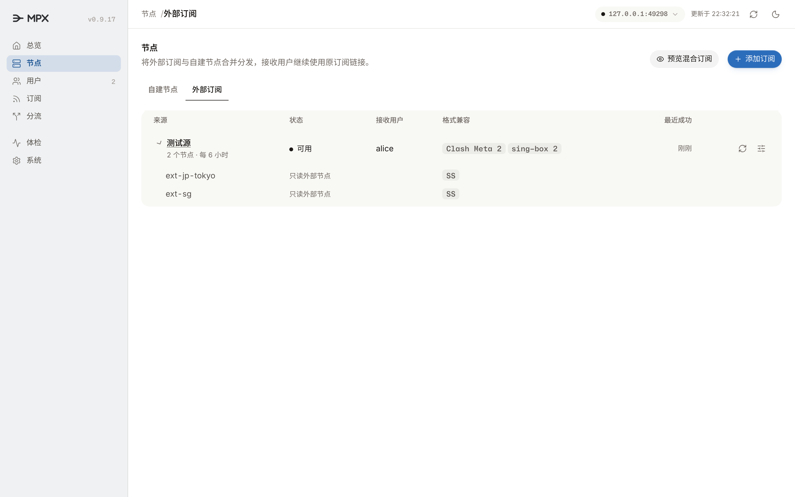
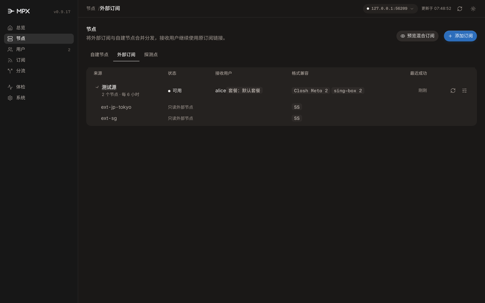
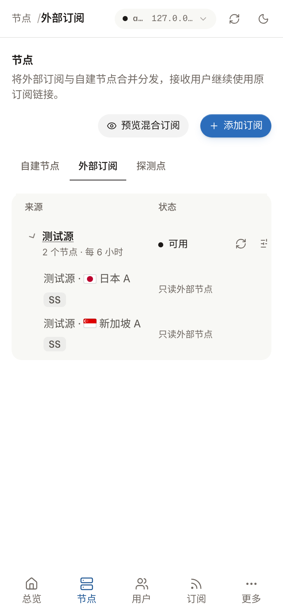
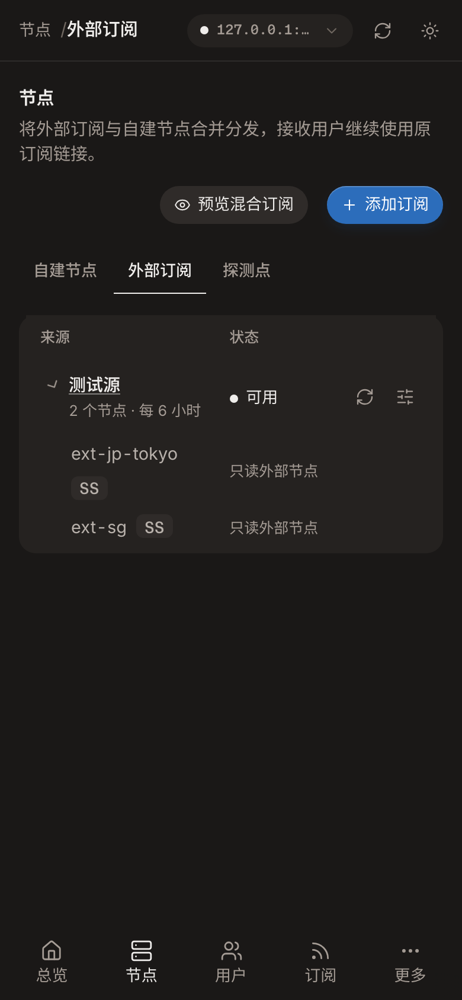
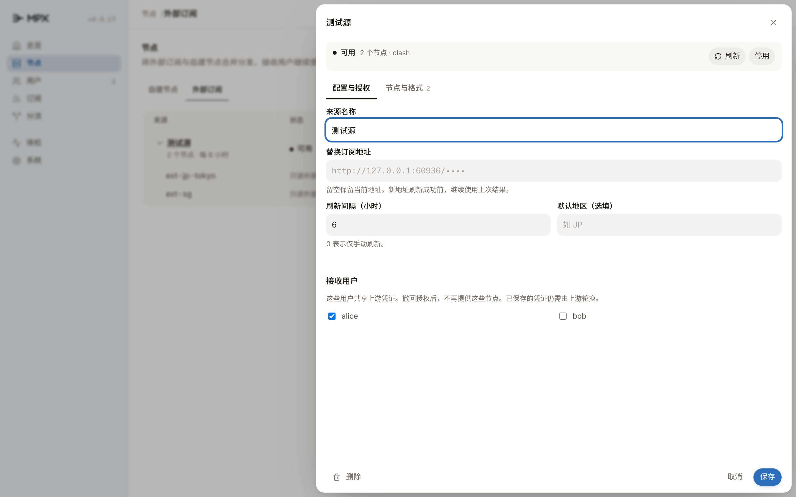
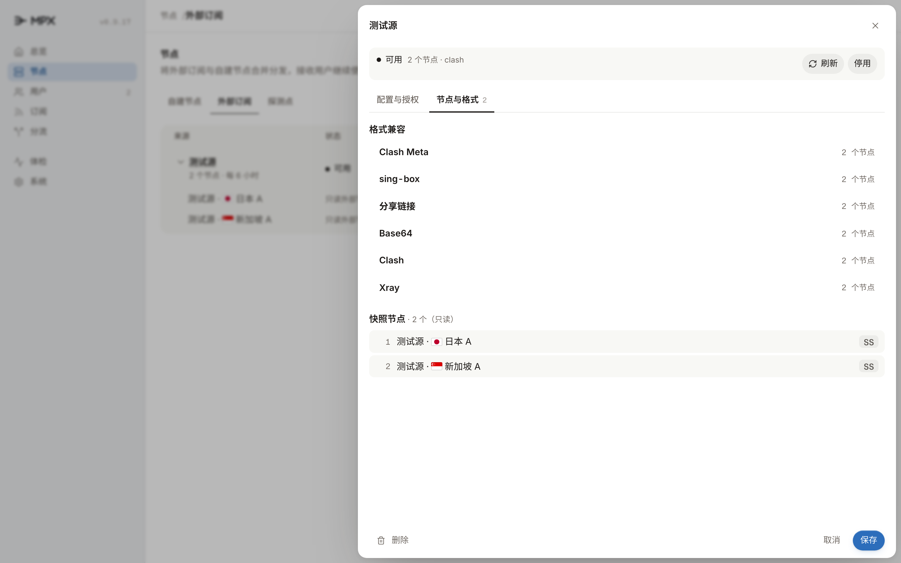
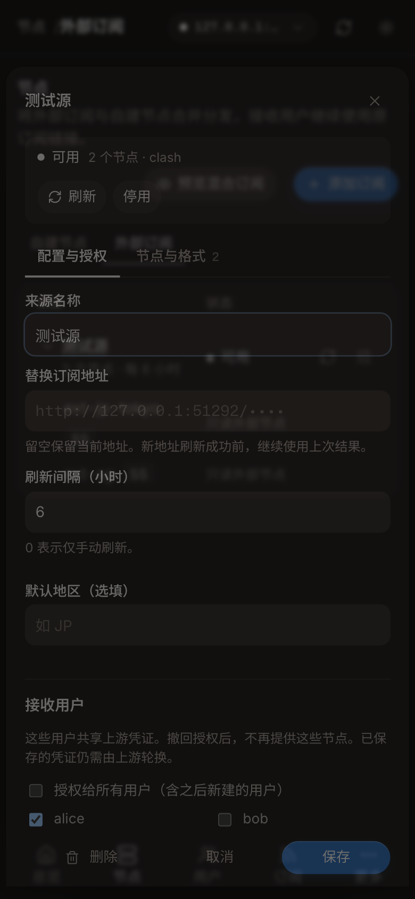
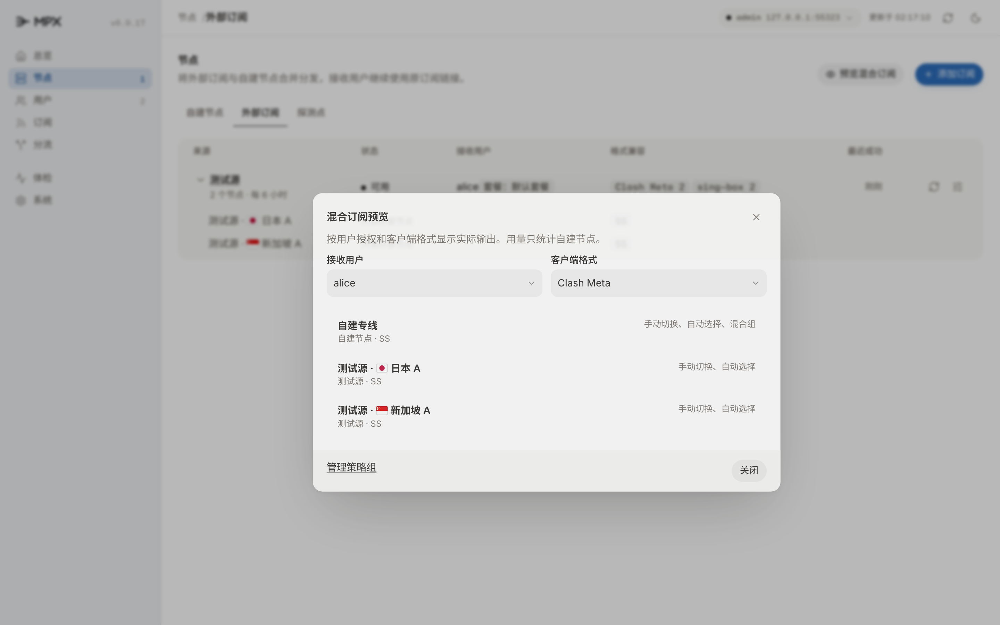

# UC-03 界面验收记录

日期：2026-11-16（Round 4 更新，基于 2026-11-09 初始验收）。范围：外部订阅收纳进「节点」页二级页签、可展开来源列表、两分段详情抽屉（单次保存）、按需混合订阅预览弹窗与策略组来源条件。

## 结果

- 外部订阅从顶级侧栏移除，收纳进「节点」页二级页签（`自建节点 | 外部订阅`，对应 `#nodes` / `#nodes/sources`）；旧地址 `#sources` 与 `sources/*` 重定向至 `#nodes/sources`。
- 订阅页保留第三张卡片中的「管理外部订阅」跳转入口，指向 `#nodes/sources`。
- 「节点 > 外部订阅」页签提供单张可展开来源表：行内展示接收用户与状态，按需展开只读成员节点（仅名称与协议，无节点动作），操作区提供刷新与详情入口。
- 详情抽屉采用「配置与授权 | 节点与格式」两分段（支持键盘方向键与草稿保留）及底部单次保存（串联来源 PATCH 与授权 PUT）；异步刷新独立轮询并保留编辑状态。
- 混合订阅预览从页面底部平铺改为页头「预览混合订阅」弹窗，按接收用户与客户端格式计算实际输出，Escape 关闭后焦点返回触发按钮。
- 策略组继续支持来源条件按用户预览与「来源不符」排除提示。
- 390px 窄屏无横向滚动，列表、展开行、抽屉与预览弹窗均不溢出视口，深浅主题继承现有根主题。

## 自动验证（2026-11-16 Round 4）

- 前端规范与类型：`npm run ui:check`、`npm run ui:typecheck`、`npm run ui:build` 通过。
- Go 测试与静态检查：`go vet ./...`、`go test ./... -count=1` 全部通过（含 `TestSourceListIncludesGrants` 验证 `GET /api/sources` 返回 `grants`）。
- 全量 Playwright E2E（`CI=1 TZ=Asia/Shanghai npx playwright test -c internal/ui/e2e`）：361 项通过，8 项按既有条件跳过，0 项失败。
- 文档巡检：`python3 scripts/atlas_audit.py` 无与本改动相关的断链或陈旧提示。

所有上游均为测试样本。没有使用实际订阅账户或生产凭证。当前验收不代表所有供应商配置均受支持。

## 截图

