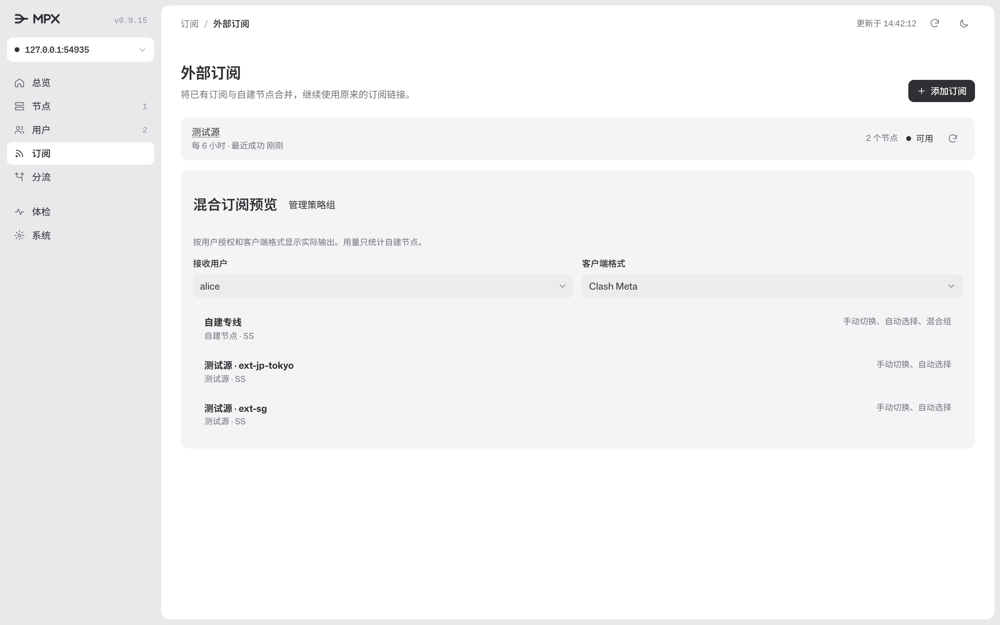
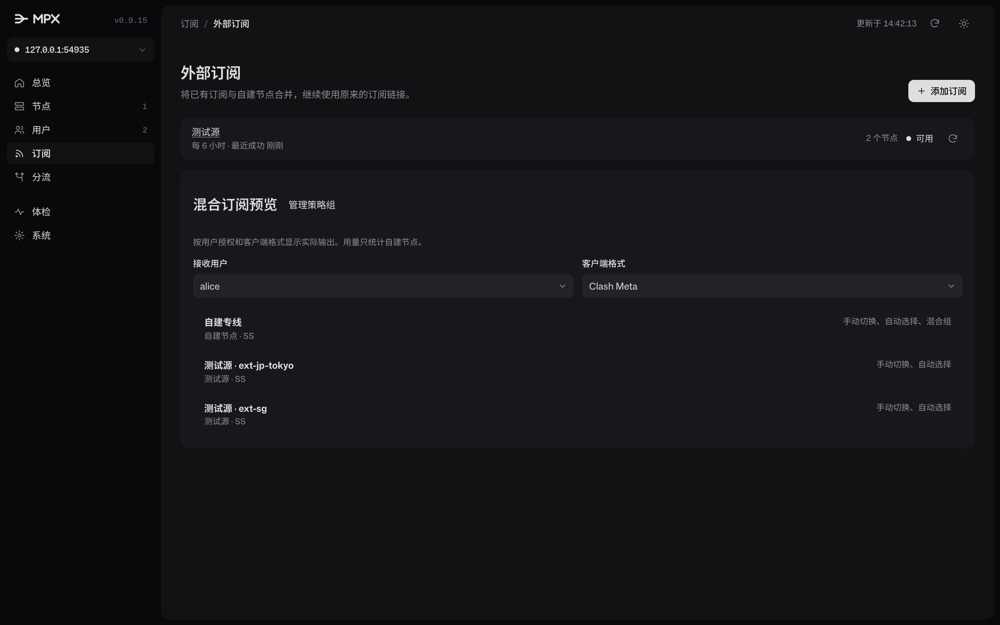
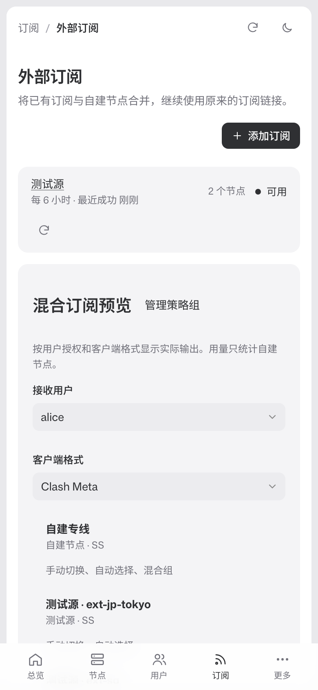
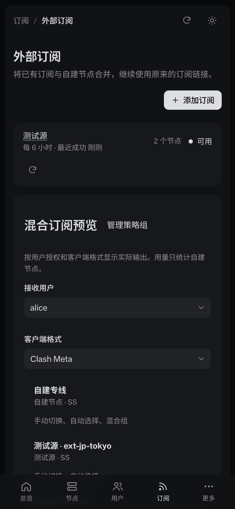
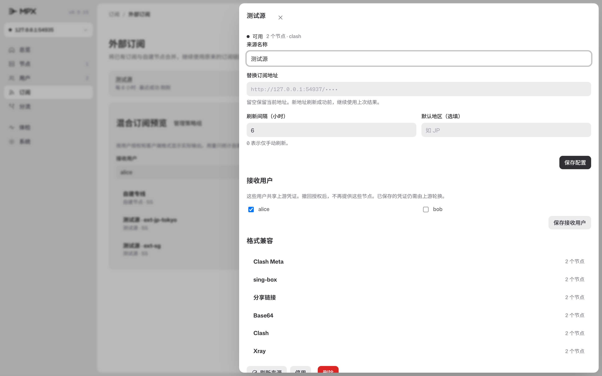
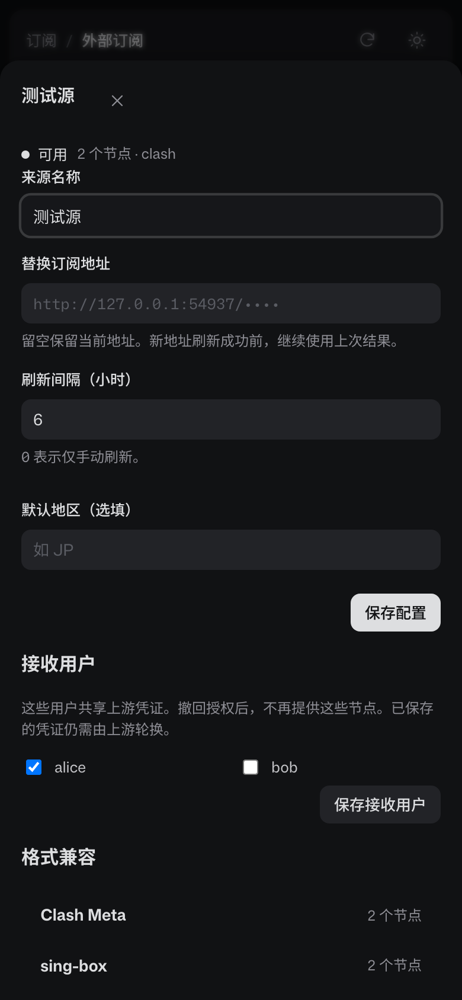

# UC-03 界面验收记录

日期：2026-11-09。范围：外部订阅入口、来源管理、授权、混合预览和策略组来源条件。

## 结果

- 页面入口位于“订阅”页头，名称为“管理外部订阅”。原来的四段内容结构保留。
- 来源列表显示刷新状态、有效节点数和最近成功时间。
- 来源详情支持配置、授权和格式报告。详情抽屉可以滚动到底部。
- 异步刷新只更新结果区域，保留正在编辑的配置。
- 预览按用户与格式计算。策略组预览同时显示成员和排除原因。
- 390px 窄屏没有横向滚动。键盘焦点保持在抽屉内，Escape 关闭后返回触发按钮。
- 深浅主题继承现有根主题。页面复用当前版本的组件、布局和图标，不依赖并行任务尚未提交的界面规范。

## 独立审查

独立审查者实现并运行了 9 个浏览器用例。审查者未实现产品界面。

审查发现详情内容断开 Flex 布局，导致底部操作不可达。现已修正，并重新验证滚动和操作。

策略组预览保留排除项，并显示“来源不符”。测试分别核对实际成员与排除原因。

审查者与实现者均检查了 2x 截图。没有发现阻断操作的布局问题。移动端刷新按钮会换行，不影响使用。

## 自动验证

- 新增来源用例：9 项通过。
- 共享工作区全量 Playwright：336 项通过，8 项按现有条件跳过，0 项失败。
- 独立提交候选基于当前主干，排除并行 UX 改动：316 项通过，8 项按现有条件跳过，0 项失败。20 项差异来自并行任务尚未合入的用例，外部订阅的 9 项用例均通过。
- Go 全量、`go vet`、`ui:check` 和文档构建通过。
- 来源并发回归通过 race detector。
- 真正运行两次控制面进程，验证重启后保留授权并刷新到期来源。
- 官方 sing-box 1.14.3 与 mihomo 1.19.33 分别通过自建 VLESS 与外部 Shadowsocks 连接测试服务。
- 两个核心均通过混合协议配置校验。实际连通测试覆盖上述 VLESS 与 Shadowsocks 组合。

所有上游均为测试样本。没有使用实际订阅账户或生产凭证。当前验收不代表所有供应商配置均受支持。

## 截图

