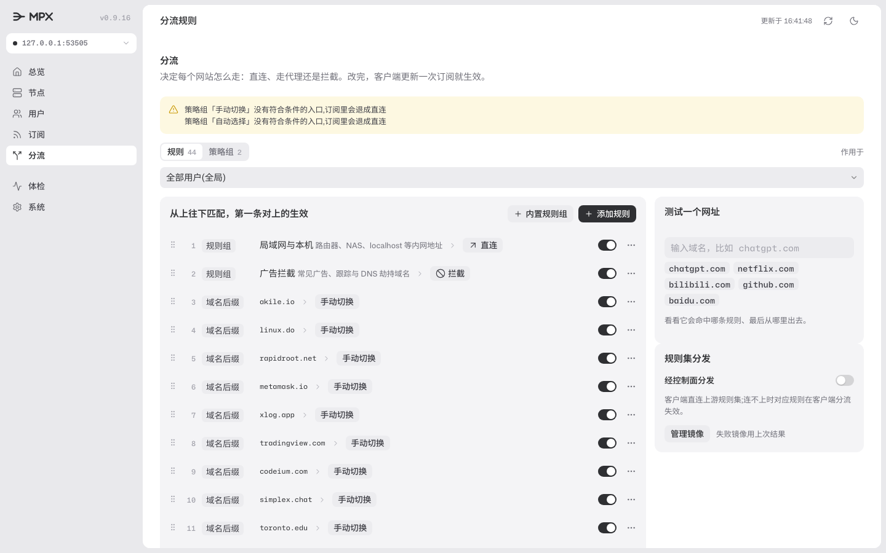
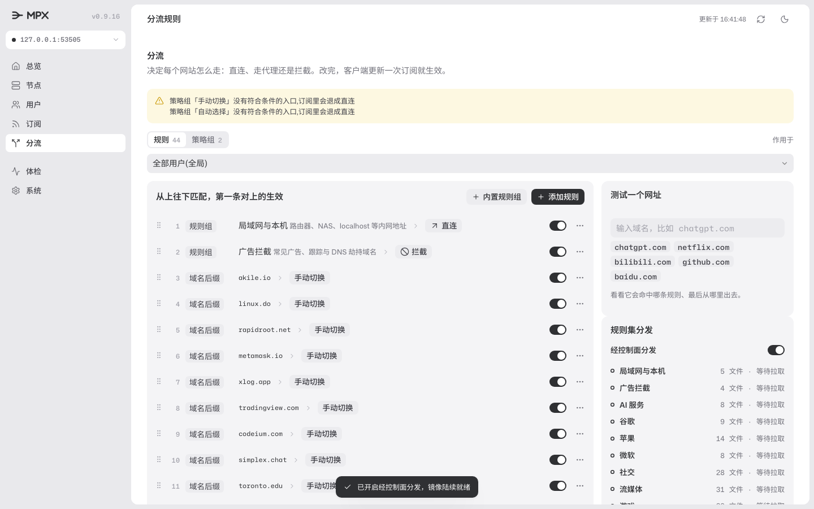
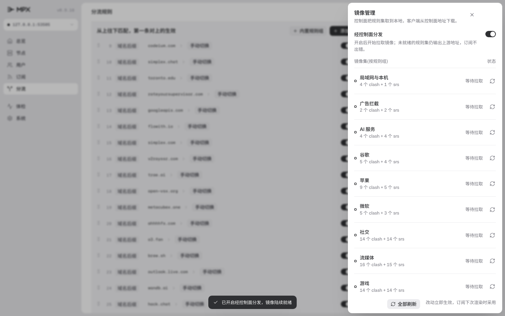

# UC-05 界面验收记录

日期：2026-11-12。范围：分流页侧栏「规则集分发」卡、「管理镜像」抽屉、镜像状态展示。

## 结果

- 入口位于分流页右侧栏，「测试一个网址」下方，名称为「规则集分发」。
- 开关为乐观交互：点击即翻状态，写 `settings.ruleset_mode` 失败时翻回并提示。
- 关闭时显示一句说明与「管理镜像」按钮；开启后列出被规则表引用的规则组，含文件数与状态。
- 抽屉列出每个组的 clash 与 srs 文件数、组级状态与失败原因，支持逐组刷新与全部刷新。
- 沙箱无上游网络时组显示「等待拉取 / 刷新失败」，不影响订阅渲染（未就绪文件仍输出上游地址）。
- 2 个 Playwright 用例通过：开关写 settings、抽屉按组与全部刷新的请求形状。
- `rules.spec.mjs` 与 `sub.spec.mjs` 全量回归通过（38 项）。

## 截图

## 自动验证

- `go vet ./... && go test ./... -count=1` 通过；新增 ruleset / store / server / cli 用例全绿。
- `npm run ui:typecheck` 与 `npm run ui:check` 通过。
- Playwright：`ruleset.spec.mjs` 2 项、`rules.spec.mjs` + `sub.spec.mjs` 40 项通过。

## 已知限制

- 沙箱环境无法访问上游规则集（jsdelivr），「就绪」态与镜像 URL 改写只在 Go 层以 httptest 验证；真实下发的镜像地址在投产环境首验。
- 抽屉内镜像状态不实时轮询；刷新按钮触发后靠写后刷新取一次最新状态。
