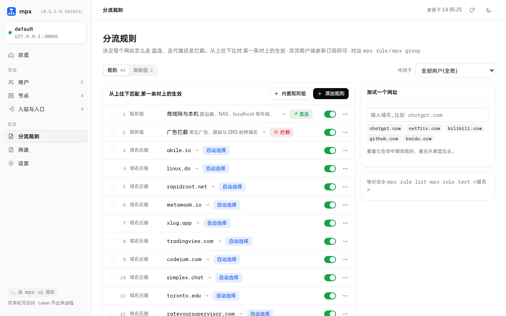
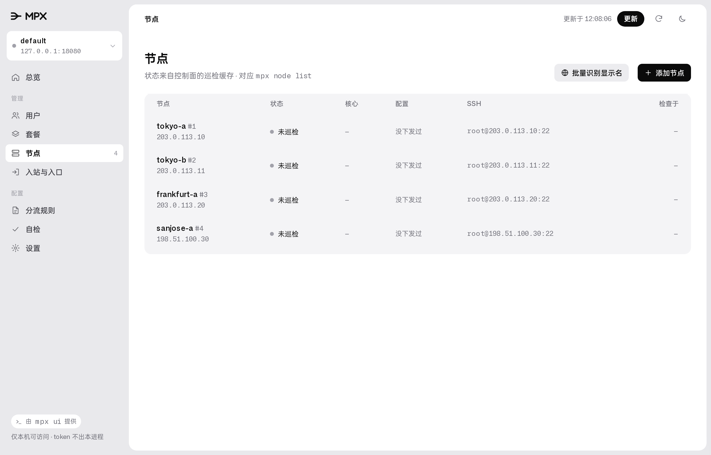
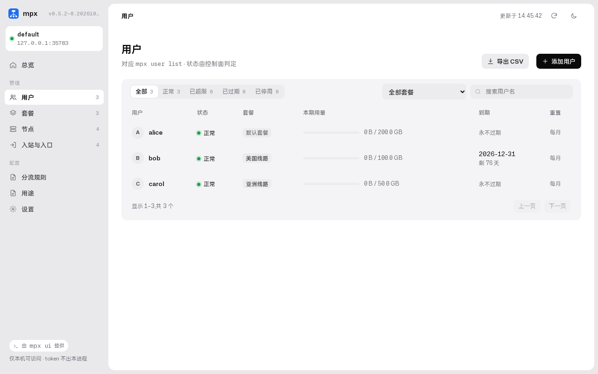
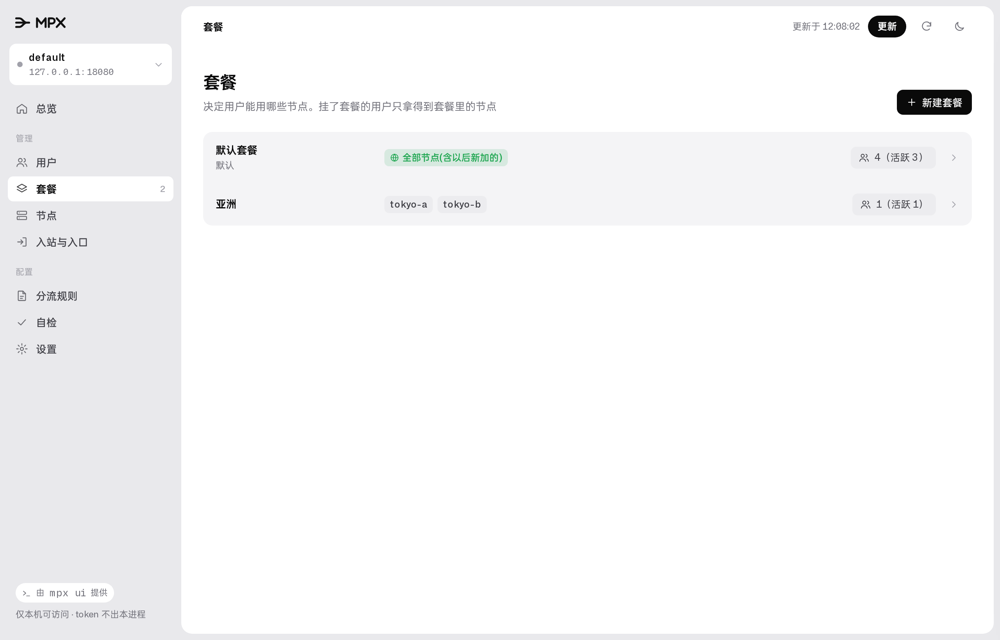

<div align="center">

<picture><source media="(prefers-color-scheme: dark)" srcset="docs/public/lockup-dark.svg"></picture>

# MPX

### 自建多节点代理，在自己电脑上管完。

**在自己电脑上管好几台代理 VPS：装机、加人、加服务器、升级都在 MPX 桌面程序里点，不用登 VPS。**<br>
节点跑 Xray（VLESS + REALITY 等）或 sing-box（Hysteria2 / TUIC），订阅自动适配 Clash、sing-box、v2rayN、Shadowrocket 等客户端。

[](https://github.com/RovenEverward/my-proxy/releases/latest) [](go.mod) [](LICENSE)<br>
  

**下载：[Windows](https://github.com/RovenEverward/my-proxy/releases/latest/download/MPX-Windows-x64-setup.exe)** &nbsp;·&nbsp; **[macOS](https://github.com/RovenEverward/my-proxy/releases/latest/download/MPX-macOS.dmg)** &nbsp;·&nbsp; **[Linux .deb](https://github.com/RovenEverward/my-proxy/releases/latest/download/MPX-Linux-amd64.deb)**（[ARM](https://github.com/RovenEverward/my-proxy/releases/latest/download/MPX-Linux-arm64.deb)） &nbsp;·&nbsp; [全部文件](https://github.com/RovenEverward/my-proxy/releases/latest)<br>
**[文档](https://RovenEverward.github.io/my-proxy/)** &nbsp;·&nbsp; **[快速开始](https://RovenEverward.github.io/my-proxy/tutorial/quickstart)** &nbsp;·&nbsp; **[更新记录](CHANGELOG.md)**

<br>

<picture>
  <source media="(prefers-color-scheme: dark)" srcset="docs/assets/readme/rules-dark.png">
  
</picture>

</div>

<br>

## 适合你吗？

手上有几台 VPS，想给自己和几个朋友用，又不想每次加人、换节点都 SSH 上去改 JSON。MPX 把这些事收进一个控制面，你在自己电脑上的 MPX 桌面程序里操作：

- **一个向导起步**：打开 MPX，填 VPS 的 IP 和 root 密码，向导把它装成控制面加节点，最后给出一条能直接用的订阅链接和二维码。
- **人和流量分开管**：每个人有自己的订阅、流量上限、重置周期和到期日；改完 30 秒内同步到节点，不重启。
- **订阅自动适配客户端**：同一条地址，Clash Meta、sing-box、v2rayN 各自拿到认识的格式，浏览器打开是用量页。

只有一台机器、只有你一个人用、也不打算加人的话，手写一份配置就够了。

## 快速开始

准备一台能用 root SSH 登录的 Linux VPS，和你自己的电脑（macOS、Windows 或 Linux）。

**1 · 安装 MPX。** 下载桌面安装包（链接永远指向最新版）：

| 你的电脑 | 下载 | 怎么装 |
| :--- | :--- | :--- |
| Windows（64 位） | [MPX-Windows-x64-setup.exe](https://github.com/RovenEverward/my-proxy/releases/latest/download/MPX-Windows-x64-setup.exe) | 双击安装，不需要管理员 |
| macOS（Intel 与 Apple 芯片） | [MPX-macOS.dmg](https://github.com/RovenEverward/my-proxy/releases/latest/download/MPX-macOS.dmg) | 打开后把 MPX 拖进「应用程序」 |
| Ubuntu / Debian（x86_64） | [MPX-Linux-amd64.deb](https://github.com/RovenEverward/my-proxy/releases/latest/download/MPX-Linux-amd64.deb) | 双击安装 |
| Ubuntu / Debian（ARM） | [MPX-Linux-arm64.deb](https://github.com/RovenEverward/my-proxy/releases/latest/download/MPX-Linux-arm64.deb) | 双击安装 |
| 其他 Linux | [最新发布页](https://github.com/RovenEverward/my-proxy/releases/latest)的 `MPX-<版本>-Linux-amd64.tar.gz` | 解压后运行 `./install.sh` |

<sub>安装包没有签名，第一次打开要放行一次：Windows 的 SmartScreen 提示时点「更多信息」→「仍要运行」；macOS 在「应用程序」里右键 MPX →「打开」，或到「系统设置 → 隐私与安全性」点「仍要打开」。Linux 桌面版需要 WebKitGTK 4.1。</sub>

**2 · 打开 MPX，点「首次安装（新服务器）」。** 填 VPS 的 IP 和 root 密码，设一个**设备密码**（以后别的电脑接入时用，不是 VPS 密码），点「开始安装」。向导装好控制面、第一个节点和第一个用户，全程不用登录 VPS。

**3 · 填进客户端。** 完成页给出订阅链接和二维码，导入 Clash Verge、sing-box、v2rayN 或 Shadowrocket。

完整步骤和截图见[快速开始](https://RovenEverward.github.io/my-proxy/tutorial/quickstart)。

<details>
<summary>用命令行代替桌面程序</summary>

**1 · 装命令行。** 在[发布页](https://github.com/RovenEverward/my-proxy/releases/latest)下载 `mpx_` 开头的命令行安装包，或者：

```bash
curl -fsSL https://raw.githubusercontent.com/RovenEverward/my-proxy/main/deploy/install-cli.sh | bash
```

<sub>装到 `~/.local/bin/mpx`。Windows 用 PowerShell：`irm https://raw.githubusercontent.com/RovenEverward/my-proxy/main/deploy/install-cli.ps1 | iex`。两个脚本都按同一个顺序找二进制：手边的 → 发布件 → 用本机 Go 从源码编。</sub>

**2 · 装控制面和第一个节点。** 把 `203.0.113.10` 换成你的 VPS 公网 IP：

```bash
mpx init --host 203.0.113.10 --ssh-password
```

它先请你设一个**设备密码**（以后别的设备接入时用，不是 VPS 密码），再要一次 SSH 密码，之后全程改用密钥。接着装好控制面（systemd 服务，监听 `0.0.0.0:8080`）、建节点 `default` 和一个 VLESS + REALITY 入站、建用户 `user1`、装 xray 并下发配置。最后打印订阅地址，以及一行给其他设备用的接入命令：

```text
别的设备接入这个控制面,装好 mpx 后跑这一行,再输入刚设的设备密码:
  mpx connect 203.0.113.10:8080 --fp SHA256:DU4SswBA8LrUy6O0MfhRRxLJZ2p8GPREpV2Zfxtj9Wg
```

**3 · 填进客户端。** 把输出里 `auto` 那条订阅地址导入 Clash Verge、sing-box、v2rayN 或 Shadowrocket。

重复跑 `mpx init` 是安全的，已有的节点、入站、用户都会复用。

**`mpx init` 的常用参数**

| 参数 | 默认 | 说明 |
| :--- | :--- | :--- |
| `--host` | *(必填)* | VPS 的地址 |
| `--ssh-user` | `root` | SSH 登录用户，必须是 root（装 systemd 服务、写 `/etc/mpx` 都要 root） |
| `--ssh-password` | — | 带它才提示输密码；不带则用密钥（`--identity` 指定私钥） |
| `--ssh-port` | `22` | SSH 端口 |
| `--binary` | — | 指定本机编好的 Linux `mpx` 传上去，适合 VPS 连不上 GitHub 的情况 |
| `--addr` | `0.0.0.0:8080` | 控制面监听地址 |
| `--username` / `--name` | `user1` / `default` | 默认用户与节点名 |
| `--sni` / `--reality-dest` | `www.cloudflare.com` | REALITY 借用的目标站点 |
| `--sub-prefix` | `http://<host>:8080` | 订阅地址前缀，换了域名要改它（不要带 `/sub`） |

非交互运行时用环境变量 `MPX_DEVICE_PASSWORD` 给出设备密码。`mpx init` 只做单机全包（控制面和节点在同一台）；要分开部署或加更多节点，看 `mpx node add`、`mpx inbound add`、`mpx host add` 的 `--help`，里面有能直接跑的例子。

命令行的日常操作：

```bash
mpx status                                     # 总览：控制面、节点、版本、有没有新发布
mpx node add tyo-1 --address 198.51.100.7      # 再加一台节点，控制面按 IP 自动起显示名
mpx user add bob --limit 100GB --reset-strategy monthly --expire 2026-12-31
mpx user links bob                             # 拿他的订阅地址
mpx node drain la-1                            # 维护前排空：不踢活跃连接，新订阅不再给它
mpx doctor                                     # 只读自检：控制面、每台节点、各种订阅格式
mpx ui                                         # 没有桌面环境时，在本机浏览器里打开同一套管理界面
```


</details>

## 能做什么

### 在桌面窗口里管

MPX 桌面程序双击就打开一个窗口，不经过浏览器。用户、套餐、节点、分流规则、设置都在里面改；删除这类危险操作要逐字输入名字确认。没有桌面环境时，`mpx ui` 在浏览器里打开同一套页面。

<table>
<tr>
<td width="50%">
<picture>
  <source media="(prefers-color-scheme: dark)" srcset="docs/assets/readme/nodes-dark.png">
  
</picture>
</td>
<td width="50%">
<picture>
  <source media="(prefers-color-scheme: dark)" srcset="docs/assets/readme/users-dark.png">
  
</picture>
</td>
</tr>
</table>

### 节点和账号

- **免证书防探测**：原生支持 VLESS REALITY，借用主流站点的 TLS 指纹，不用域名和证书。
- **多协议**：Xray 用户通过 gRPC 热更新；Hysteria2 / TUIC 跑在独立的 sing-box 服务上，两种核心的流量计入同一个用户配额（QUIC 名单变化会重启该节点的 QUIC 连接）。
- **节点自动起名**：新节点按 IP 查 ipwho.is，起成 `🇺🇸 洛杉矶 A` 这样的显示名，订阅里也用它。关掉用 `mpx serve --auto-locate=false` 或 `MPX_AUTO_LOCATE=0`；手动改用 `mpx node edit la-1 --region US --city 洛杉矶`，老节点批量起名用 `mpx node relabel --all --dry-run` 先看对照表。
- **用名字指定对象**：要写 id 的地方都能写名字（不区分大小写）、显示名或唯一前缀，入站写成 `节点/tag`，例如 `mpx inbound show la/reality`。命中多个时列出候选，不会猜。

### 订阅和分流

- **按客户端下发**：按 `User-Agent` 返回 Clash Meta、sing-box 或 Base64 订阅，浏览器打开是用量和能力页。
- **分流规则**：一张从上往下匹配的规则表，每条指向直连、拦截或策略组；内置常用规则组，可以给某个用户单独加规则，也能测试一个网址会走哪里。对应 `mpx rule`、`mpx group`。旧的「用途」已在 v0.7.0 删除。
- **套餐**：按节点给一组人授权，每个用户挂一个套餐；自带包含全部节点的「默认套餐」。对应 `mpx plan`、`mpx user add --plan`。

<picture>
  <source media="(prefers-color-scheme: dark)" srcset="docs/assets/readme/plans-dark.png">
  
</picture>

### 运维

- **多设备接入**：别的电脑用 `mpx connect` 加设备密码接入，每台设备一枚自己的 token，丢了用 `mpx device` 吊销。
- **一键体检**：`mpx node diagnose ID` 或 `--all` 汇总节点健康、配置漂移、真实代理入口和上游测评（默认运行 Go ECS 融合怪 v0.2.12；有流量上限的节点用 `--engine light`）。
- **下发不怕写坏**：下发前自动跑 `xray -test`，失败秒级回滚；节点掉线按指数退避重试。
- **备份**：内置 SQLite 在线热备，`mpx backup` 下载，`mpx restore` 暂存换入。

## 它怎么连起来

```
  MPX 桌面程序 / mpx CLI (你的电脑)          客户端 (mihomo / sing-box / v2rayN)
         │                                               │
         │ /api (设备 token, HTTPS)                      │ /sub/<token> (订阅)
         ▼                                               ▼
    ┌─────────────────────────── 控制面 ───────────────────────────┐
    │  SQLite: 节点 / 入站 / 对外入口 / 用户 / 分流规则 / 设置      │
    │  订阅分发: links / clash-meta / sing-box / xray / HTML 用量页 │
    │  后台循环: 流量采样 → 周期重置 → 人员收敛 → 节点探活         │
    └──────────────────────────────┬───────────────────────────────┘
                                   │ SSH 声明式下发 + 各核心统计 API
                 ┌─────────────────┼─────────────────┐
                 ▼                 ▼                 ▼
              节点 A            节点 B            节点 C    (Xray / sing-box)
```

用户流量直连各节点，不经过控制面。控制面在 `8080` 一个端口上同时提供订阅（HTTP）和管理接口（HTTPS，用安装时生成的证书，命令行按指纹认它）。订阅地址是明文 HTTP，长期使用可以在前面放一个 TLS 反向代理，再用 `--sub-prefix https://你的域名` 换前缀。

## 升级

有新版本时，MPX 窗口右上角出现「更新」按钮。点一次，依次升级控制面、各节点的代理核心和桌面程序本身，完成后自动重启。见[一键更新](https://RovenEverward.github.io/my-proxy/guides/update)。

用命令行升级：

```bash
mpx update show                  # 看本机 CLI、控制面、各节点核心的当前版本和最新版本（只读）
mpx update apply cli             # 升级本机 CLI，核对 SHA256SUMS 后替换，旧文件留作回退
mpx update apply control         # 让控制面升级到最新版，失败会自动回退
mpx update rollback control      # 控制面退回上一版
mpx update rollback cli          # 本机 CLI 退回上一版
```

`--version v0.6.1` 指定版本，`-y` 跳过确认（脚本里必须加）。升级控制面时，`mpx update apply control` 会一路报告下载、校验、切换、健康检查各阶段；控制面重启的几秒里连不上属于正常，命令会继续等。数据库、token 和密钥都不会动，升级前仍建议备份数据库。

**从 v0.6.0 及以前升级时**，还要在 VPS 上跑一次安装脚本，装上本机升级需要的组件，之后就能在本机升级了：

```bash
curl -fsSL https://raw.githubusercontent.com/RovenEverward/my-proxy/main/deploy/install.sh | sudo bash -s -- --version v0.6.1 --addr 0.0.0.0:8080
```

`--addr` 写成当初装的监听地址（`mpx init` 默认是 `0.0.0.0:8080`）。新版脚本没给 `--addr` 时会沿用现有 mpx.service 里的监听地址，写上更保险。

每版改了什么写在 [CHANGELOG.md](CHANGELOG.md) 和 [Releases 页](https://github.com/RovenEverward/my-proxy/releases)。没有发布件、也不方便联网时，可以把二进制直接递给脚本：`sudo ./deploy/install.sh /tmp/mpx`。

<details>
<summary>Tab 补全、本地跑控制面</summary>

节点名、入站、用户名都能按 Tab 补全：

```bash
source <(mpx completion bash)                  # bash，写进 ~/.bashrc 长期生效
mpx completion zsh > "${fpath[1]}/_mpx"        # zsh
mpx completion fish > ~/.config/fish/completions/mpx.fish
```

不装服务，直接在本机跑一个前台控制面试试：

```bash
go build -o mpx ./cmd/mpx
./mpx serve --db ~/mpx.db
```

</details>

## 文档

- **教程**：[快速开始](https://RovenEverward.github.io/my-proxy/tutorial/quickstart)
- **指南**：[添加用户并分发订阅](https://RovenEverward.github.io/my-proxy/guides/add-users) ｜ [添加节点](https://RovenEverward.github.io/my-proxy/guides/add-nodes) ｜ [用套餐分配节点](https://RovenEverward.github.io/my-proxy/guides/plans) ｜ [设置分流规则](https://RovenEverward.github.io/my-proxy/guides/routing) ｜ [让某个客户端拿到指定格式](https://RovenEverward.github.io/my-proxy/guides/client-format) ｜ [在多台设备上管理](https://RovenEverward.github.io/my-proxy/guides/devices) ｜ [一键更新](https://RovenEverward.github.io/my-proxy/guides/update) ｜ [备份控制面](https://RovenEverward.github.io/my-proxy/guides/backup) ｜ [用自检排查](https://RovenEverward.github.io/my-proxy/guides/troubleshoot)
- **参考**：[界面](https://RovenEverward.github.io/my-proxy/reference/interface) ｜ [订阅设置](https://RovenEverward.github.io/my-proxy/reference/settings) ｜ [订阅接口](https://RovenEverward.github.io/my-proxy/reference/subscription) ｜ [命令行](https://RovenEverward.github.io/my-proxy/reference/cli)
- **原理**：[控制面与节点](https://RovenEverward.github.io/my-proxy/concepts/architecture)
- **开发者入口**（只在仓库里）：[docs/atlas](docs/atlas/README.md)：MPX 由哪几块组成、怎么配合，以及设计、决策、RFC 等全部内部文档的地图。

文档站由 `docs/` 下的 markdown 经 [VitePress](https://vitepress.dev/) 生成，推 `main` 后由 [docs.yml](.github/workflows/docs.yml) 发布。本地预览：`npm install && npm run docs:dev`。

## 参与开发

见 [CONTRIBUTING.md](CONTRIBUTING.md)。提交前跑：

```bash
go test ./... -count=1 -race
gofmt -l .
```

## 致谢

README 的排版参考了 [magpie](https://github.com/yetone/magpie)。

## 许可证

[MIT](LICENSE)
