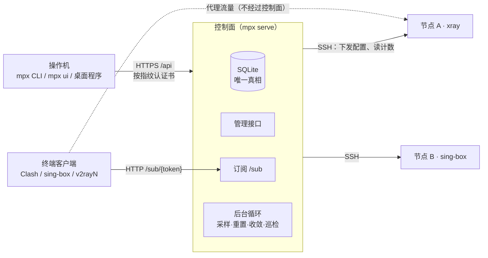

# MPX：新人导览

> **30 秒版**：MPX 是一个自建代理的控制面。手上有几台 VPS、要给自己和几十到上千个朋友分代理的人，用它把「谁能用哪些节点、用了多少、什么时候到期、订阅该长什么样」收进一台控制面里管。控制面持有唯一一份真相，替你给每台节点上的 xray / sing-box 下发配置、按人计流量、按客户端出订阅；你在自己电脑上用命令行 `mpx`、本地网页 `mpx ui` 或桌面程序操作，装好之后不用再登录 VPS。

## 愿景与思想

> 待确认：本节由 Agent 从 [README](../../README.md)、[设计](../design.md)、[路线图](../internal/roadmap.md)、[关键决策与理由](../internal/decisions.md) 和各份 RFC 里提炼，没有加进仓库之外的说法。属于守护层，请主人逐段确认或改写。

MPX 想做的是：一个人、没有团队也没人值班，也能把几台到几十台服务器、几百上千个用户管得清清楚楚，而且这件事不需要一直盯着。手工维护一台 xray 还行，机器和人一多就会出四种错：真相散在各台机器和表格里，改一处要重启断掉所有人，客户端手里的订阅悄悄过期，超限和到期没人去算。MPX 的回答是一个地方存唯一一份真相，由它算出每个节点上该是什么、每个人该拿到什么，再送过去。

贯穿全局的想法有两个。第一，**控制面是大脑，节点只是执行器**：节点上不装任何 MPX 组件，只用 SSH 和 xray 自带的接口；配置全量渲染下发，改结构才重启，加人摘人走每 30 秒一轮的收敛、不碰别人的连接；流量读累计值，账不会丢。第二，**用户永远不用登录 VPS**：一行 `mpx init` 在自己电脑上经 SSH 把 VPS 装好，之后每台设备按证书指纹、用设备密码接入控制面，各自可吊销。

操作的入口始终只有一套能力：命令行是基准，`mpx ui` 把同样的事搬进本机浏览器，桌面程序再把 `mpx ui` 装进一个窗口。界面可以先行（「UI 优先」：每个功能都要能在 `mpx ui` 里做），但不长出控制面接口之外的能力，每个写操作都能用等价命令做出来。控制面的接口只增不破，旧客户端必须照常工作。

判断「做得好」的标准写在决策记录的口吻里：错了也看不出来的问题最优先（静默丢账先于一切）；一份坏配置、一条坏规则不能让整个订阅不可用；能拒绝自己的安装和升级才安全；不可用的用户要看得出来是停用、过期还是超限。

现在做到了：一键安装、多节点多协议（含 sing-box 承载的 Hysteria2 / TUIC）、用户与套餐、按规则表分流、远程升级与回滚、`mpx ui` 的添加节点和首次安装向导、桌面程序的设计与 Linux 冒烟。接下来的方向见 [路线图](../internal/roadmap.md) 和 [桌面程序方案](../internal/desktop-rfc.md)：补齐 UI 缺口、桌面安装包与自更新、三平台 CI。

## 思想地图

| 思想 | 一句话 | 读完能明白什么 | 文档 |
|---|---|---|---|
| 唯一真相，节点是执行器 | 控制面算好再推过去，节点什么都不装 | 为什么改结构要重启、加人不用；为什么账不会丢 | [ideas/single-source-of-truth.md](ideas/single-source-of-truth.md) |
| 不登录 VPS | 装、接入、升级都在自己设备上完成 | 为什么有 `init`、指纹、设备密码、远程升级 | [ideas/never-ssh-again.md](ideas/never-ssh-again.md) |
| 一个入口，多张面孔 | CLI、`mpx ui`、桌面程序共用一套接口和边界 | 为什么 UI 不直接对外、接口只增不破 | [ideas/one-entry-many-faces.md](ideas/one-entry-many-faces.md) |

## 你需要知道的术语

| 术语 | 白话解释 | 代码里叫 |
|---|---|---|
| 控制面 | 跑 `mpx serve` 的那台机器，持有数据库，对外提供管理接口和订阅 | `internal/server`、`internal/control` |
| 节点 | 跑 xray 或 sing-box、真正承载用户流量的服务器 | `model.Node` |
| 入站 | 节点上监听的一个端口加协议，比如 VLESS + REALITY 的 443 | `model.Inbound` |
| 对外入口（host） | 订阅里发出去的地址，一个入站可以挂多个 | `model.Host` |
| 套餐 | 一组入站权限，用户挂上就能用这些入站 | `model.Plan` |
| 收敛 | 每 30 秒比对「节点上有谁」和「该有谁」，只增删用户、不重启 | `control` 的 loop |
| 占位节点 | 给停用、过期、超限用户的连不通但客户端肯接受的配置 | `render` |
| 设备密码 / 指纹 | 新设备接入控制面的凭据，以及认控制面自签证书的方式 | `internal/pin`、`mpx connect` |

## 组成

| 部分 | 一句话 | 什么时候读 | 文档 |
|---|---|---|---|
| 控制面与数据 | 唯一一份真相：SQLite、管理接口、备份 | 改表、改 `/api`、改备份恢复 | [control-plane.md](control-plane.md) |
| 节点：下发、收敛与巡检 | 把真相送到节点上，按人计量，发现漂移 | 改 `internal/control`、`internal/node`、节点配置渲染 | [nodes.md](nodes.md) |
| 用户、套餐与计量 | 谁能用哪些入站、用了多少、什么时候停 | 改用户字段、配额、重置、套餐 | [users.md](users.md) |
| 订阅与分流 | 同一条地址按客户端出格式，按规则表分流 | 改 `/sub`、`internal/render`、规则和策略组 | [subscription.md](subscription.md) |
| 本机入口：CLI、`mpx ui`、设备接入 | 操作者手里的全部入口 | 改 `internal/cli`、`internal/ui`、`internal/pin` | [operator-entry.md](operator-entry.md) |
| 安装与升级 | 从一台裸 VPS 到可用，再到远程升级回滚 | 改 `mpx init`、`deploy/`、`mpx update`、发版 | [install-update.md](install-update.md) |
| 体检与诊断 | 入口能力检测、一键体检、自检 | 改 `internal/diagnostics`、`internal/fusion`、`doctor` | [diagnostics.md](diagnostics.md) |

桌面程序还在设计与穿刺阶段，代码不在 main 上，方案见 [桌面程序方案](../internal/desktop-rfc.md)。

## 怎么配合

操作机只和控制面的管理接口说话，从不碰数据库和节点；控制面只在两件事上碰节点：下发结构（会重启）和读流量计数；用户流量直接从客户端打到节点，控制面挂了也不影响已经连上的人。一个端口按首字节分流，HTTPS 给管理接口，HTTP 给订阅。

**走查：给朋友 alice 开一个账号**

1. 你在自己电脑上跑 `mpx user add alice --plan 标准 --limit 100GB`（不带 `--plan` 就归默认套餐），或在 `mpx ui` 的用户页点「新建」。CLI 把它拼成一个 `/api` 请求（[internal/cli/user.go](../../internal/cli/user.go)），按控制面证书指纹建立 HTTPS 连接。这台电脑之前已经接入过控制面：跑 `mpx init` 的那台自动接入；别的设备用 `mpx connect` 加安装时设的设备密码接入，见 [本机入口](operator-entry.md)。
2. 控制面的管理接口（[internal/server](../../internal/server/)）校验 token，写进 SQLite（[internal/store](../../internal/store/)）。节点上这时一个字节都没动。见 [控制面与数据](control-plane.md)。
3. 下一轮后台循环（最多 30 秒）先采样、再重置、最后收敛：发现 alice 该在套餐里的那几个入站上，就经 SSH 调 xray 的 `adu` 把她加进去，不重启（[internal/control/loop.go](../../internal/control/loop.go)）。见 [节点](nodes.md)。
4. 你把 `mpx user show alice` 里的订阅地址发给她。她的 Clash Verge 拉 `/sub/{token}`，控制面按 User-Agent 认出是 Clash Meta，用规则表生成带策略组的 YAML（[internal/render](../../internal/render/)）。见 [订阅与分流](subscription.md)。
5. alice 连上节点开始用。之后每 30 秒她的用量被累计进库；超过 100GB，下一轮她被从节点上摘掉，订阅变成写着「已超限」的占位节点。见 [用户、套餐与计量](users.md)。

后台每一轮的细节、下发文件和订阅响应的真实样子，见 [mpx 是怎么搭起来的](../internal/index.md)。

## 文档地图

| 文档 | 在哪 | 给谁 | 活的 / 冻结 | 谁维护 |
|---|---|---|---|---|
| 项目介绍与快速开始 | [README.md](../../README.md) | 路过的人、新用户 | 活的 | 主人 |
| 贡献指南（测试、文档站、发布） | [CONTRIBUTING.md](../../CONTRIBUTING.md) | 贡献者 | 活的 | 主人 |
| 更新记录 | [CHANGELOG.md](../../CHANGELOG.md) | 用户、升级的人 | 只追加 | 发版时 |
| Agent 入口 | [AGENTS.md](../../AGENTS.md) | 进仓库的 Agent | 活的 | 主人（硬约束是守护层） |
| 设计：为什么要有、形态、不做什么 | [docs/design.md](../design.md) | 开发者 | 活的，偏稳定 | 主人 |
| 运行时走查 | [docs/internal/index.md](../internal/index.md) | 开发者 | 活的 | 随代码 |
| 数据模型与语义 | [docs/internal/model.md](../internal/model.md) | 开发者 | 活的 | 随代码 |
| 对外契约（CLI、API、订阅、节点侧） | [docs/internal/contracts.md](../internal/contracts.md) | 开发者、写客户端的人 | 活的 | 随代码 |
| 关键决策与理由（决策日志） | [docs/internal/decisions.md](../internal/decisions.md) | 开发者、将来的主人 | 守护层，只追加 | 主人 |
| 现状与验证程度 | [docs/internal/status.md](../internal/status.md) | 开发者 | 活的 | 随版本 |
| 路线图 | [docs/internal/roadmap.md](../internal/roadmap.md) | 开发者、主人 | 活的 | 主人 |
| 缺口与待定项 | [docs/internal/open-questions.md](../internal/open-questions.md) | 主人 | 活的 | 主人 |
| RFC：管理 UI | [ui-rfc.md](../internal/ui-rfc.md) | 开发者 | 冻结（已采纳，已实现） | — |
| RFC：设备接入 | [device-connect-rfc.md](../internal/device-connect-rfc.md) | 开发者 | 冻结（已实现） | — |
| RFC：节点展示名 | [node-naming-rfc.md](../internal/node-naming-rfc.md) | 开发者 | 冻结（N1–N6 已实现） | — |
| RFC：自动升级与 `mpx update` | [update-rfc.md](../internal/update-rfc.md) | 开发者 | 冻结（M1–M3、M6 已实现；节点核心与一键三层见 decisions 第 39 条，M5 自动策略不做） | — |
| RFC：分流规则（替代用途） | [routing-rules-rfc.md](../internal/routing-rules-rfc.md) | 开发者 | 冻结（已实现，用途已于 v0.7.0 删除） | — |
| RFC：套餐 | [plans-rfc.md](../internal/plans-rfc.md) | 开发者 | 冻结（P1–P3 已实现） | — |
| RFC：两个向导 | [wizard-rfc.md](../internal/wizard-rfc.md) | 开发者 | 冻结（v0.6.4 已实现） | — |
| RFC：桌面程序 | [desktop-rfc.md](../internal/desktop-rfc.md) | 开发者 | 冻结（已批准，D 批次进行中） | — |
| 验证记录：能力检测、一键体检、QUIC | [capability](../internal/capability-validation.md)、[diagnostic](../internal/diagnostic-validation.md)、[QUIC](../internal/quic-validation.md) | 开发者 | 冻结 | — |
| 用户文档站（教程、指南、参考、原理） | [首页](../index.md)、[tutorial/](../tutorial/)、[guides/](../guides/)、[reference/](../reference/)、[concepts/](../concepts/)，线上 [RovenEverward.github.io/my-proxy](https://RovenEverward.github.io/my-proxy/) | 用户 | 活的 | 见 doc-user |
| issue 与讨论 | [GitHub issues](https://github.com/RovenEverward/my-proxy/issues?q=is%3Aissue) | 开发者 | 讨论过程，结论进仓库 | — |
| 审计脚本 | [scripts/atlas_audit.py](../../scripts/atlas_audit.py) | 维护者、Agent | 活的 | 从 doc-atlas 技能同步 |
