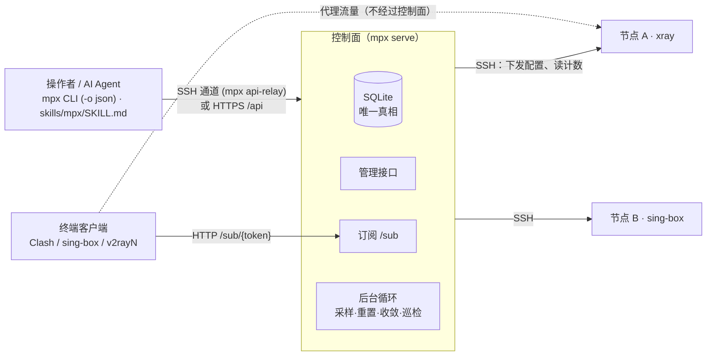

# MPX：新人导览

> **30 秒版**：MPX 是一个面向极客与 AI Agent 的纯 Go 极简代理编排核心。手上有几台 VPS、要给自己和几十到上千个朋友分代理的人，用它把「谁能用哪些节点、用了多少、什么时候到期、订阅该长什么样」收进一台控制面（单二进制 + SQLite）里管。控制面持有唯一一份真相，替你给每台节点上的 xray / sing-box 校验并原子下发配置、按人无重启计流量、按客户端出多格式订阅；操作者或 AI Agent 通过 `mpx` 命令行（`-o json` / `--ssh` 通道）与官方 [Agent Skill](../../skills/mpx/SKILL.md) 完成全部运维。

## 愿景与思想

MPX 想做的是：一个人、没有团队也没人值班，也能把几台到几十台服务器、几百上千个用户管得清清楚楚，而且把维护成本压到最低。在 AI Agent 已经能直接 SSH 运维服务器的背景下，重型 Web 面板、桌面壳和常驻探测/测评任务的维护成本远高于价值；但多节点代理仍有三件不能靠临时脚本凑合的确定性底层活——声明式多节点配置编排与回滚、无重启按人计量收敛、7×24 确定性多格式订阅分发。

贯穿全局的想法有三个。第一，**控制面是唯一真相，节点只是执行器**：节点上不装任何 MPX 组件，只用 SSH 和核心自带的 API；结构变更先 `--dry-run` 预检再 `node sync` 校验下发（失败自动回滚），加人摘人走每 30 秒一轮的收敛、不碰在线连接，流量读累计值不会静默丢账。第二，**Agent-Native 极简单体**：只留单一纯 Go 二进制与一套结构化 CLI 契约（`-o json`、非交互参数、清晰退出码、`--ssh` 免密通道、随仓分发 `skills/mpx/SKILL.md`），不内置 Web 管理台、常驻 CDN 探测点或重型融合怪测评；高灵活度的按需排障与本机真实网络 CDN 优选交给操作者或 AI Agent 执行，结果经 `mpx host` / `mpx rule` 写回控制面。第三，**订阅契约优先**：同一条 `/sub/<token>` 持续稳定输出 Clash Meta、sing-box、Xray、Base64 与轻量浏览器用量页，一份坏配置或坏规则不能拖垮订阅服务。

判断「做得好」的标准写在决策记录的口吻里：错了也看不出来的问题最优先（静默丢账先于一切）；一份坏配置、一条坏规则不能让整个订阅不可用；能拒绝自己的安装和升级才安全；不可用的用户要看得出来是停用、过期还是超限。

现在做到了：纯 Go 单体一键安装、多节点多协议（含 sing-box 承载的 Hysteria2 / TUIC）、用户与套餐、按规则表分流与规则集镜像、外部订阅混入、订阅镜像、远程升级与回滚、SSH 通道免密接入、`node sync --dry-run` 预检与官方 Agent Skill。

## 思想地图

| 思想 | 一句话 | 读完能明白什么 | 文档 |
|---|---|---|---|
| 唯一真相，节点是执行器 | 控制面算好再推过去，节点什么都不装 | 为什么改结构要重启、加人不用；为什么账不会丢 | — |
| Agent-Native 纯 Go 单体 | 只留确定性核心与结构化 CLI + Skill，把灵活探测交给 Agent | 为什么砍掉 Web UI、内置 CDN 探测与融合怪，改用 `--ssh` 与 `-o json` | — |
| 订阅契约优先 | 客户端链接与格式零破坏，异常状态清晰可辨 | 为什么退役旧表只迁移不删表、占位节点要说清停用/过期/超限 | — |

## 你需要知道的术语

| 术语 | 白话解释 | 代码里叫 |
|---|---|---|
| 控制面 | 跑 `mpx serve` 的那台机器，持有数据库，对外提供管理接口和订阅 | `internal/server`、`internal/control` |
| 节点 | 跑 xray 或 sing-box、真正承载用户流量的服务器 | `model.Node` |
| 入站 | 节点上监听的一个端口加协议，比如 VLESS + REALITY 的 443 | `model.Inbound` |
| 对外入口（host） | 订阅里发出去的地址，一个入站可以挂多个（含 Agent 按需优选的 CDN IP） | `model.Host` |
| 套餐 | 一组入站权限，用户挂上就能用这些入站 | `model.Plan` |
| 收敛 | 每 30 秒比对「节点上有谁」和「该有谁」，只增删用户、不重启 | `control` 的 loop |
| 占位节点 | 给停用、过期、超限用户的连不通但客户端肯接受的配置 | `render` |
| SSH 通道 / 管理员账号 | `mpx connect --ssh` 走 `api-relay` 免密接入；无 SSH 环境用管理员账号 + 证书指纹 / ACME 接入 | `internal/cli/ssh.go`、`internal/cli/admin.go`、`internal/pin` |

## 组成

| 部分 | 一句话 | 什么时候读 | 文档 |
|---|---|---|---|
| 控制面与数据 | 唯一一份真相：SQLite、管理接口、备份 | 改表、改 `/api`、改备份恢复 | [control-plane.md](control-plane.md) |
| 节点：下发、收敛与巡检 | 把真相送到节点上，按人计量，发现漂移 | 改 `internal/control`、`internal/node`、节点配置渲染 | [nodes.md](nodes.md) |
| 用户、套餐与计量 | 谁能用哪些入站、用了多少、什么时候停 | 改用户字段、配额、重置、套餐 | [users.md](users.md) |
| 订阅与分流 | 同一条地址按客户端出格式，按规则表分流 | 改 `/sub`、`internal/render`、规则和策略组 | [subscription.md](subscription.md) |
| 本机入口：CLI 与 Agent Skill | 操作者与 AI Agent 的统一入口 | 改 `internal/cli`、`internal/pin`、`skills/mpx/` | [operator-entry.md](operator-entry.md) |
| 安装与升级 | 从一台裸 VPS 到可用，再到远程升级回滚 | 改 `mpx init`、`deploy/`、`mpx update`、发版 | [install-update.md](install-update.md) |
| 能力检测、质量评级与自检 | 入口能力检测、IP 质量评级、`doctor` 自检 | 改 `doctor`、`capability`、`quality` | [diagnostics.md](diagnostics.md) |

## 怎么配合

操作机只和控制面的管理接口说话，从不碰数据库和节点；控制面只在两件事上碰节点：下发结构（会重启）和读流量计数；用户流量直接从客户端打到节点，控制面挂了也不影响已经连上的人。一个端口按首字节分流，HTTPS 给管理接口，HTTP 给订阅。

**走查：给朋友 alice 开一个账号**

1. 你或 AI Agent 在自己电脑上跑 `mpx user add alice --plan 标准 --limit 100GB -o json`（不带 `--plan` 就归默认套餐）。CLI 把它拼成一个 `/api` 请求（[internal/cli/user.go](../../internal/cli/user.go)），经 `--ssh` 通道（或按证书指纹/ACME 校验的 HTTPS）发给控制面。这台电脑之前已经接入过控制面：跑 `mpx init` 的那台自动走 SSH 通道；别的设备用 `mpx connect --ssh` 或密码登录接入，见 [本机入口](operator-entry.md)。
2. 控制面的管理接口（[internal/server](../../internal/server/)）校验 token，写进 SQLite（[internal/store](../../internal/store/)）。节点上这时一个字节都没动。见 [控制面与数据](control-plane.md)。
3. 下一轮后台循环（最多 30 秒）先采样、再重置、最后收敛：发现 alice 该在套餐里的那几个入站上，就经 SSH 调 xray 的 `adu` 把她加进去，不重启（[internal/control/loop.go](../../internal/control/loop.go)）。见 [节点](nodes.md)。
4. 你把 `mpx user show alice` 里的订阅地址发给她。她的 Clash Verge 拉 `/sub/{token}`，控制面按 User-Agent 认出是 Clash Meta，用规则表生成带策略组的 YAML（[internal/render](../../internal/render/)）。见 [订阅与分流](subscription.md)。
5. alice 连上节点开始用。之后每 30 秒她的用量被累计进库；超过 100GB，下一轮她被从节点上摘掉，订阅变成写着「已超限」的占位节点。见 [用户、套餐与计量](users.md)。

后台每一轮的细节、下发文件和订阅响应的真实样子，见 [mpx 是怎么搭起来的](../internal/index.md)。

## 文档地图

| 文档 | 在哪 | 给谁 | 活的 / 冻结 | 谁维护 |
|---|---|---|---|---|
| 项目介绍与快速开始 | [README.md](../../README.md) | 路过的人、新用户 | 活的 | 主人 |
| 官方 Agent Skill | [skills/mpx/SKILL.md](../../skills/mpx/SKILL.md) | Coding Agent / 自动化运维 | 活的 | 随 CLI 契约 |
| 贡献指南（测试、文档站、发布） | [CONTRIBUTING.md](../../CONTRIBUTING.md) | 贡献者 | 活的 | 主人 |
| 更新记录 | [CHANGELOG.md](../../CHANGELOG.md) | 用户、升级的人 | 只追加 | 发版时 |
| Agent 入口 | [AGENTS.md](../../AGENTS.md) | 进仓库的 Agent | 活的 | 主人（硬约束是守护层） |
| 设计：为什么要有、形态、不做什么 | [docs/design.md](../design.md) | 开发者 | 活的，偏稳定 | 主人 |
| 运行时走查 | [docs/internal/index.md](../internal/index.md) | 开发者 | 活的 | 随代码 |
| 数据模型与语义 | [docs/internal/model.md](../internal/model.md) | 开发者 | 活的 | 随代码 |
| 对外契约（CLI、API、订阅、节点侧） | [docs/internal/contracts.md](../internal/contracts.md) | 开发者、写客户端的人 | 活的 | 随代码 |
| 用户文档站（教程、指南、参考、原理） | [首页](../index.md)、[tutorial/](../tutorial/)、[guides/](../guides/)、[reference/](../reference/)、[concepts/](../concepts/)，线上 [RovenEverward.github.io/my-proxy](https://RovenEverward.github.io/my-proxy/) | 用户 | 活的 | 见 doc-user |
| issue 与讨论 | [GitHub issues](https://github.com/RovenEverward/my-proxy/issues?q=is%3Aissue) | 开发者 | 讨论过程，结论进仓库 | — |
| 审计脚本 | [scripts/atlas_audit.py](../../scripts/atlas_audit.py) | 维护者、Agent | 活的 | 从 doc-atlas 技能同步 |
