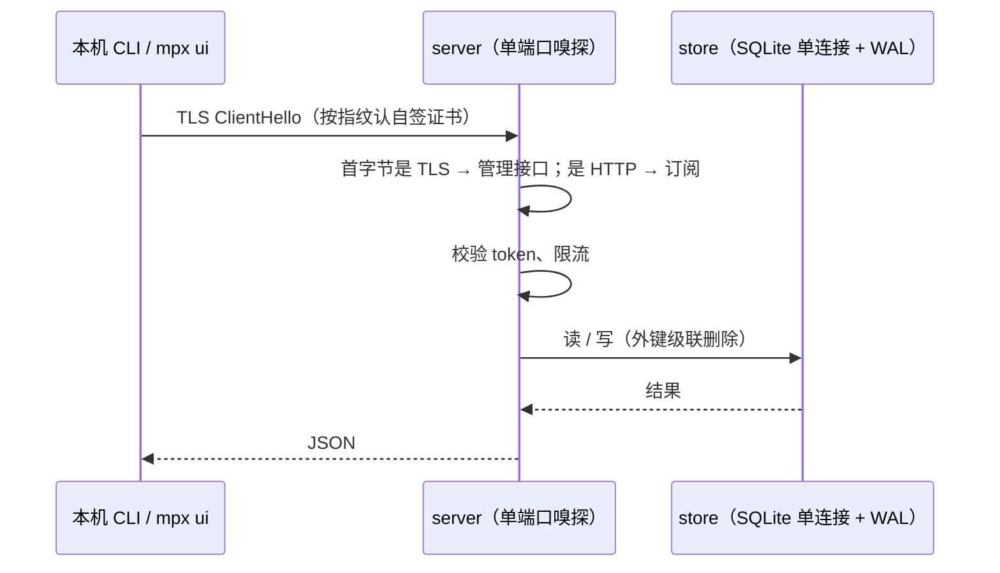

# 控制面与数据

> **30 秒版**：控制面是一台机器上跑的 `mpx serve`，持有 SQLite 里唯一一份真相（节点、入站、对外入口、用户、套餐、规则、设备），对外只开一个端口：HTTPS 给管理接口 `/api`，HTTP 给订阅 `/sub`。其余各块要么往这里写，要么从这里读。

## 边界

负责：存数据、校验写入、提供管理接口和订阅接口、鉴权（主 token 加每设备 token）、限流、备份与恢复。

不负责：碰节点（交给 [节点](nodes.md) 那一块的后台循环）；渲染订阅内容（交给 [订阅与分流](subscription.md)）；承载用户流量（控制面不进数据通路）。

## 怎么运转

1. 一个端口按首字节分流（[internal/server/sniff.go](../../internal/server/sniff.go)），管理接口走控制面自签的 HTTPS（[decisions 第 38 条](../internal/decisions.md)），订阅留在 HTTP，因为代理客户端普遍不认自签证书。
2. 路由集中在 [internal/server/server.go](../../internal/server/server.go)。管理接口只增不破：新字段可以加，旧字段和旧路径不能改语义。
3. 持久化在 [internal/store](../../internal/store/)：SQLite 单连接加 WAL，写入串行；级联删除靠外键；迁移在启动时跑，只能往前加。
4. 领域对象在 [internal/model](../../internal/model/)，字段与状态判定的语义写在 [数据模型与语义](../internal/model.md)，接口的确切形状写在 [对外契约](../internal/contracts.md)。
5. 备份含库和控制面的 SSH 私钥，不含管理 token；恢复是「暂存，重启时换入」（[internal/backup](../../internal/backup/)，decisions 第 16 条）。

## 为什么这样设计

单库单进程，是因为目标规模是一个人管几十台节点、上千用户：零依赖、备份就是拷一个文件，代价是规模上限在一台机器（decisions 第 10 条）。控制面启动时不下发配置（第 4 条），避免一次重启牵连所有节点。

## 坑

- 想给接口改字段语义 → 旧 CLI、旧 `mpx ui` 会静默出错 → 只加新字段或新路径；确实要破坏兼容，先停下来问主人。
- 建用户时不带 `enabled` → 零值会被当成停用 → 必须显式传（decisions 第 35 条）。
- 节点和入口的地区元数据（region / city / letter）在 `metadata.go`（server、store）和 `model/location.go`，类型叫 `LocationMetadata`；v0.9.2 前这些文件叫 `purpose.go`。代码里剩下的 `purposes` 字样只在迁移和兼容旧报告的地方（`dropPurposes`、`LegacyPurposeCount`、`PurposeOutcome`），「用途」本身已在 v0.7.0 删除。
- 仍是 `template` 分流模式的老库 → v0.7.0 起控制面拒绝启动 → 先用 v0.6.6 跑 `mpx rule migrate`（见 [CHANGELOG](../../CHANGELOG.md) v0.7.0）。
