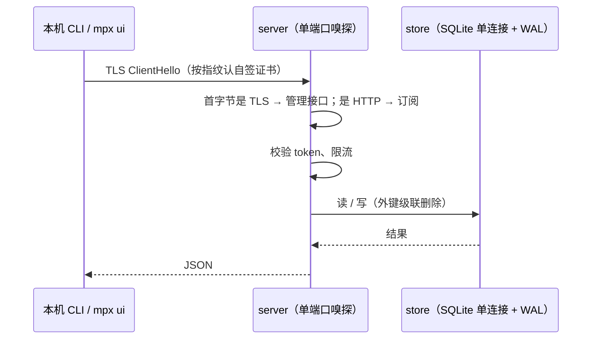

# 控制面与数据

> **30 秒版**：控制面是一台机器上跑的 `mpx serve`，持有 SQLite 里唯一一份真相（节点、入站、对外入口、用户、套餐、规则、设备），对外只开一个端口：HTTPS 给管理接口 `/api`，HTTP 给订阅 `/sub`。其余各块要么往这里写，要么从这里读。

## 边界

负责：存数据、校验写入、提供管理接口和订阅接口、鉴权（主 token 加每设备 token）、限流、备份与恢复。

不负责：碰节点（交给 [节点](nodes.md) 那一块的后台循环）；渲染订阅内容（交给 [订阅与分流](subscription.md)）；承载用户流量（控制面不进数据通路）。

## 怎么运转

1. 一个端口按首字节分流（[internal/server/sniff.go](../../internal/server/sniff.go)），管理接口走控制面自签的 HTTPS，订阅留在 HTTP，因为代理客户端普遍不认自签证书。
2. 路由集中在 [internal/server/server.go](../../internal/server/server.go)。管理接口只增不破：新字段可以加，旧字段和旧路径不能改语义。
3. 持久化在 [internal/store](../../internal/store/)：SQLite 单连接加 WAL，写入串行；级联删除靠外键；迁移在启动时跑，只能往前加。
4. 领域对象在 [internal/model](../../internal/model/)，字段与状态判定的语义写在 [数据模型与语义](../internal/model.md)，接口的确切形状写在 [对外契约](../internal/contracts.md)。
5. 备份含库和控制面的 SSH 私钥，不含管理 token；恢复是「暂存，重启时换入」。外部订阅地址、节点快照、授权及来源条件属于库内敏感内容，随备份恢复。
6. 外部订阅的配置、快照、用户/套餐授权和策略组来源条件分别持久化，见 [source.go](../../internal/store/source.go)。`subscription_sources.grant_all` 列（`migrateSources` 内补列，勿放 `addedColumns` —— 那时表可能还没建）表示全员授权，开启时按人/按套餐授权表不参与可见性但保留记录。`plan_source_grants` 是来源↔套餐多对多（删任一侧级联清记录）；`PUT /api/sources/{id}/grants` 的 `users` 与 `plan_ids` 两个键独立替换，缺哪个键保留哪份，老客户端只发 `users` 不会清套餐授权。授权与来源条件仅由新增专用接口写入，旧用户和策略组 PUT 不覆盖这些关系。来源删除级联移除快照与授权，组条件保留失效来源 ID。
7. 订阅镜像(UC-10)经 `GET/POST/PUT/DELETE /api/mirrors` 管理，`sub_mirrors` 表挂 `nodes` 外键级联。`mpx serve --sub-addr`(或 `MPX_SUB_ADDR`)能另开一个只路由 `/sub` 的纯 HTTP 监听；把镜像指到它时 `/api` 不会出现在镜像端口,比把镜像指到主监听(同端口 TLS 嗅探分流)更干净。上游解析顺序:`--upstream` → `settings.SubURLPrefix` → 请求 Host,非 host:port 或推不出来时回警告。
8. IP 质量评分(UC-14)存 `node_quality` 表(节点外键级联，一节点一行,重测覆盖)；`POST /api/regrade` 在 `metadataMu` 下重算分组字母后经 `SaveLocationMetadataBatch` 事务批量写 `node_metadata`——不走逐节点 PUT 元数据，否则交换两个字母时第一笔下冲突 409。写完 `invalidateSubCache()` 让新订阅立即用新显示名。
9. 外部端点清洗(UC-17)分两层:快照 (`source_snapshots.endpoints`) 永远留上游原始 `Remark` 供回溯；清洗结果存 `external_metadata` 表（`source_id+source_key` 复合主键、来源外键级联，`kind` 区分 `auto` 回填与 `graded` 重排）。订阅装配与来源视图只读清洗层：`resolveExternalRemark` 拼 `源名 · 旗帜 城市/地区 字母`，无记录的端点回退 `源名 · 上游原名`。身份键是连接参数指纹 (`Endpoint.SourceKey`)，上游改名不换键。快照刷新成功后 `Manager.syncExternalMetadata` 解析地区、`AssignExternalLetters` 补字母（同地区继承已排记录的城市保持同组），`SyncExternalMetadata` 事务删去消失键并差量 upsert；地区解析顺序是旗帜 emoji → token 级 ISO 短码 → 写法表子串 → 来源「默认地区」兜底（`subscription_sources.region`，JMS 这类主机名备注全靠它），都不中不建记录。它永不覆盖 `graded` 行；`PATCH /api/sources/{id}/endpoints/{key}` 人工写地区/城市（输入经 `normalizeExternalRegion` 归一：ISO 或常见写法都收），写成 `graded`，空 region 删记录回退原名。降级评分存 `external_quality`（同键级联、重测覆盖），`POST /api/sources/{id}/endpoints/{key}/quality` 由控制面直连 ipwho.is/ipapi.is/可选 AbuseIPDB（不走 SSH，复用 `QualityScore` 权重与 `qualitySlot` 并发闸），结果并入 `POST /api/regrade` 的同一排序循环，apply 时 `SaveExternalMetadataBatch` 与 `SaveLocationMetadataBatch` 在同一个 `metadataMu` 区间写入。端点消失只清 `external_metadata`，`external_quality` 记录保留。

## 为什么这样设计

单库单进程，是因为目标规模是一个人管几十台节点、上千用户：零依赖、备份就是拷一个文件，代价是规模上限在一台机器，避免一次重启牵连所有节点。

## 坑

- 想给接口改字段语义 → 旧 CLI、旧 `mpx ui` 会静默出错 → 只加新字段或新路径；确实要破坏兼容，先停下来问主人。
- 建用户时不带 `enabled` → 零值会被当成停用 → 必须显式传。
- 节点和入口的地区元数据（region / city / letter）在 `metadata.go`（server、store）和 `model/location.go`，类型叫 `LocationMetadata`；v0.9.2 前这些文件叫 `purpose.go`。代码里剩下的 `purposes` 字样只在迁移和兼容旧报告的地方（`dropPurposes`、`LegacyPurposeCount`、`PurposeOutcome`），「用途」本身已在 v0.7.0 删除。
- 仍是 `template` 分流模式的老库 → v0.7.0 起控制面拒绝启动 → 先用 v0.6.6 跑 `mpx rule migrate`（见 [CHANGELOG](../../CHANGELOG.md) v0.7.0）。
