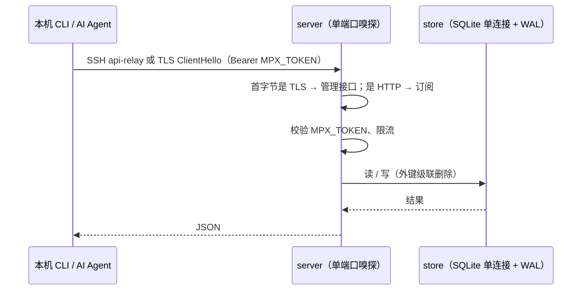

# 控制面与数据

> **30 秒版**：控制面是一台机器上跑的 `mpx serve`，持有 SQLite 里唯一一份真相（节点、入站、对外入口、用户、分流规则、外部订阅源），对外只开一个端口：HTTPS 给管理接口 `/api`，HTTP 给订阅 `/sub`（也支持 `--sub-addr` 拆出独立纯订阅监听）。其余各块要么往这里写，要么从这里读。

## 边界

负责：存数据、校验写入、提供管理接口和订阅接口、鉴权（`MPX_TOKEN` Bearer 主钥匙 / SSH `api-relay`）、限流、备份与恢复。

不负责：碰节点（交给 [节点](nodes.md) 那一块的后台循环）；渲染订阅内容（交给 [订阅与分流](subscription.md)）；承载用户流量（控制面不进数据通路）；内置证书签发（域名 HTTPS 由外部反代或 `acme.sh` 负责）。

## 怎么运转

1. 一个端口按首字节分流（[internal/server/sniff.go](../../internal/server/sniff.go)），管理接口走控制面自签的 HTTPS（或经 `mpx api-relay` 走本地回环），订阅留在 HTTP，因为代理客户端普遍不认自签证书。
2. 路由集中在 [internal/server/server.go](../../internal/server/server.go)。管理接口鉴权统一为 `MPX_TOKEN`（定长比对），不维护管理员密码或会话表。
3. 持久化在 [internal/store](../../internal/store/)：SQLite 单连接加 WAL，写入串行；级联删除靠外键；迁移在启动时跑，只能往前加。`traffic_samples` 后台循环每小时清理 7 天前的旧采样行，同时保留每个 `(node_id, core, username)` 的最新基线，防止数据库无限膨胀。
4. 领域对象在 [internal/model](../../internal/model/)，字段与状态判定的语义写在 [数据模型与语义](../internal/model.md)，接口的确切形状写在 [对外契约](../internal/contracts.md)。
5. 备份含库和控制面的 SSH 私钥，不含管理 token；恢复是「暂存，重启时换入」。外部订阅地址、节点快照、授权及来源条件属于库内敏感内容，随备份恢复。
6. 外部订阅的配置、快照、用户授权和策略组来源条件分别持久化，见 [source.go](../../internal/store/source.go)。`subscription_sources.grant_all` 列表示全员授权，开启时按人授权表（`user_source_grants`）不参与可见性但保留记录。授权与来源条件由专用接口写入，来源删除级联移除快照与授权，组条件保留失效来源 ID。
7. 订阅镜像（UC-10）经 `GET/POST/PUT/DELETE /api/mirrors` 管理，`sub_mirrors` 表挂 `nodes` 外键级联。`mpx serve --sub-addr`（或 `MPX_SUB_ADDR`）能另开一个只路由 `/sub` 的纯 HTTP 监听。上游解析顺序：`--upstream` → `settings.SubURLPrefix` → 请求 Host。
8. 外部端点清洗（UC-17）分两层：快照（`source_snapshots.endpoints`）保留上游原始 `Remark`；清洗结果存 `external_metadata` 表（`source_id+source_key` 复合主键、来源外键级联）。订阅装配与来源视图经 `resolveExternalRemark` 拼 `源名 · 旗帜 城市/地区 字母`，无记录的端点回退 `源名 · 上游原名`。身份键是连接参数指纹（`Endpoint.SourceKey`）。快照刷新成功后自动按名称旗帜/ISO 码/写法表/来源默认地区同步 `external_metadata`；`PATCH /api/sources/{id}/endpoints/{key}` 支持人工覆盖地区/城市，空 region 删记录回退原名。

## 为什么这样设计

单库单进程，是因为目标规模是一个人管几十台节点、上千用户：零依赖、备份就是拷一个文件，代价是规模上限在一台机器，避免一次重启牵连所有节点。

## 坑

- 建用户时不带 `enabled` → 零值会被当成停用 → 必须显式传。
- 节点和入口的地区元数据（region / city / letter）在 `metadata.go`（server、store）和 `model/location.go`，类型叫 `LocationMetadata`。
- 仍是 `template` 分流模式的老库 → v0.7.0 起控制面拒绝启动 → 先用 v0.6.6 跑 `mpx rule migrate`（见 [CHANGELOG](../../CHANGELOG.md) v0.7.0）。
