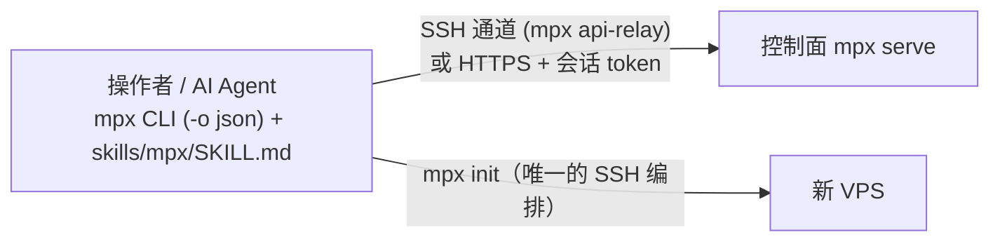

# 操作入口：CLI 与 Agent Skill

> **30 秒版**：UC-32 起网页管理台（`/admin/`、`internal/ui`）彻底退役，MPX 回归纯 Go 单体。`mpx` 命令行是 `/api` 的唯一客户端（全命令支持 `-o json` 结构化输出与失败 JSON stderr），推荐用 `mpx connect --ssh` 经 SSH 通道免密接入，也保留账号密码 + 证书指纹/ACME 受信证书接入。仓库同时提供 [skills/mpx/SKILL.md](../../skills/mpx/SKILL.md) 给 AI Agent 按契约安全运维。

## 边界

负责：把操作拼成 `/api` 请求并输出表格或 JSON；CLI 多控制面配置档与 `--ssh` 通道转发；管理员账号（`mpx admin` 建号 / 改密码）与接入（`mpx connect`）；本机编排（`mpx init` 首次安装、`mpx node relabel`）；下发前预检（`mpx node sync --dry-run` 渲染并比对 SHA-256 哈希，零 SSH 不重启）；IP 质量评级（`mpx node grade` / `mpx source grade` / `mpx node regrade`）。

已退役：
- UC-26 退役 `mpx ui` 本地服务、桌面程序与设备密码。
- UC-30 退役带宽测量与境内活性探测（`mpx node bandwidth`、`mpx node check`、`mpx reach`）。
- UC-32 退役网页管理台（`internal/ui`、`/admin/`、Node/Playwright 工具链）、内置 CDN 自动优选与探测点（`mpx cdn`、`mpx probe`、`internal/cdn`、`internal/probeagent`）以及重型内置体检（`mpx diagnose`、`mpx node diagnose`、`internal/diagnostics`、`internal/fusion`）。

不负责：碰数据库和节点（`mpx init` 是唯一例外，因为那时控制面还不存在，见 [安装与升级](install-update.md)）；常驻 CDN 测速或后台探测（CDN 优选由操作者或 AI Agent 在真实本机网络按需执行后经 `mpx host` 写入）。

## 怎么运转

1. **纯客户端语义**：CLI 不缓存数据，每条写操作都能用 `curl` 等价复现。`-o json` 模式下成功向 stdout 打缩进 JSON，失败向 stderr 打 `{"error","status_code"}` 并返回非零退出码（`doctor` 故障为 `3`）。
2. **SSH 通道优先（UC-29）**：`mpx connect <地址> --ssh [目标]` 不问密码、不核指纹、不存 token —— profile 只记 `ssh` 目标。之后每条 API 请求经 `ssh <目标> 'mpx api-relay --port <控制面端口>'` 转发至控制面回环并由远端读 `/etc/mpx/env` 注入主钥匙。`mpx init` 收尾自动切入该模式。
3. **密码与 TLS 兜底**：无 SSH 通道的环境走 `mpx connect <地址>`（支持 `--password-stdin` 非交互），经 `POST /api/admin/login`（`kind: "cli"`）换 30 天 bearer 会话 token 存入本机配置档；控制面配了 `mpx acme` 受信域名证书时自动走系统 CA 校验，否则按 `--fp` 钉自签证书指纹。改密码（`mpx admin password`）吊销全部会话。
4. **结构变更预检**：`mpx node sync --dry-run <节点>` 调用 `GET /api/nodes/{id}` 与 `GET /api/nodes/{id}/config`，计算渲染结果的 SHA-256 并与 `deployed_hash` / `observed_hash` 比对，确认影响面后再执行 `mpx node sync`。
5. **二进制构建口径**：发布、CI 与安装脚本统一使用 `CGO_ENABLED=0 go build -trimpath -tags with_utls,with_quic ./cmd/mpx`（无需 Node.js）。

## 坑

- 撞上控制面限流 → CLI 自动按 `Retry-After` 等待重试，不把 429 甩给调用方。
- 忘记 `node sync` 与自动收敛的边界 → 改用户/套餐每 30 秒热收敛、改 host/rule/group/source 立即进订阅，都不需要重启节点；只有改入站结构/证书/出口 IP 策略/镜像才需要 `mpx node sync`。
- 登录接口限速与锁定有 IP 限速 + 连续失败锁 15 分钟三道闸；测试环境用 `MPX_API_BURST` 放宽。
