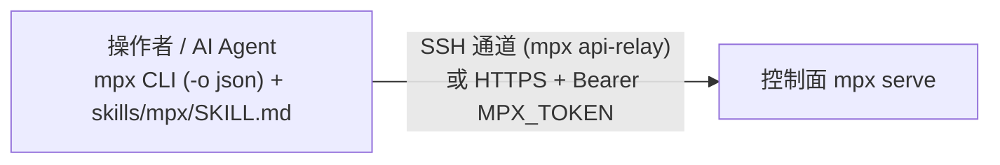

# 操作入口：CLI 与 Agent Skill

> **30 秒版**：`mpx` 命令行是 `/api` 的唯一客户端（全命令支持 `-o json` 结构化输出与失败 JSON stderr），推荐用 `mpx connect --ssh` 经 SSH 通道免密接入，也支持直连 HTTPS + `MPX_TOKEN` Bearer 主钥匙（自签证书走 `--fp` 指纹钉扎）。仓库同时提供 [skills/mpx/SKILL.md](../../skills/mpx/SKILL.md) 给 AI Agent 按契约安全运维。

## 边界

负责：把操作拼成 `/api` 请求并输出表格或 JSON；CLI 多控制面配置档与 `--ssh` 通道转发（`mpx api-relay`）；下发前预检（`mpx node sync --dry-run` 渲染并比对 SHA-256 哈希，零 SSH 不重启）；离线备份与恢复命令。

不负责：直接读写 SQLite 或直接 SSH 操作代理节点；Web 管理台、密码登录会话、交互式安装向导、自升级与主动 IP 探测。

## 怎么运转

1. **纯客户端语义**：CLI 不缓存数据，每条写操作都能用 `curl` 等价复现。`-o json` 模式下成功向 stdout 打缩进 JSON，失败向 stderr 打 `{"error","status_code"}` 并返回非零退出码（`doctor` 故障为 `3`）。
2. **SSH 通道优先（UC-29）**：`mpx connect <地址> --ssh [目标]` 不核指纹、不存 token —— profile 只记 `ssh` 目标。之后每条 API 请求经 `ssh <目标> 'mpx api-relay --port <控制面端口>'` 转发至控制面回环并由远端读 `/etc/mpx/env` 注入 `MPX_TOKEN`。
3. **直连 Token 兜底**：无 SSH 通道的环境用 `MPX_SERVER` + `MPX_TOKEN`（配合 `--fp` 或系统受信域名 CA）直接访问 `/api`。
4. **结构变更预检**：`mpx node sync --dry-run <节点>` 调用 `GET /api/nodes/{id}` 与 `GET /api/nodes/{id}/config`，计算渲染结果的 SHA-256 并与 `deployed_hash` / `observed_hash` 比对，确认影响面后再执行 `mpx node sync`。
5. **二进制构建口径**：统一使用纯 Go 静态编译 `CGO_ENABLED=0 go build -trimpath -ldflags="-s -w" ./cmd/mpx`（无需 Node.js 或额外 build tags）。

## 坑

- 撞上控制面限流 → CLI 自动按 `Retry-After` 等待重试，不把 429 甩给调用方。
- 忘记 `node sync` 与自动收敛的边界 → 改用户每 30 秒热收敛、改 host/rule/group/source 立即进订阅，都不需要重启节点；只有改入站结构/证书/出口 IP 策略/镜像才需要 `mpx node sync`。
