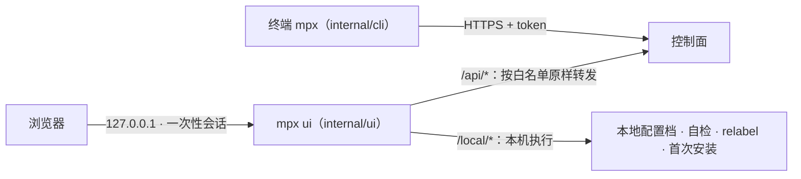

# 本机入口：CLI、mpx ui、设备接入

> **30 秒版**：操作者只在自己电脑上干活。`mpx` 命令行是 `/api` 的纯客户端；`mpx ui` 在本机起一个只听回环地址的小服务，把页面请求带上 CLI 那份 token 原样转给控制面；新设备用 `mpx connect` 加设备密码接入，按证书指纹认控制面。

## 边界

负责：把操作拼成请求、把结果显示给人；多控制面配置档；设备接入与吊销；本机才能做的事（切换 profile、自检、relabel 查 IP 归属、首次安装向导）。

不负责：碰数据库和节点（`mpx init` 是唯一例外，因为那时控制面还不存在，见 [安装与升级](install-update.md)）；长出控制面接口之外的能力。

## 怎么运转

1. CLI 每条命令都能用 `curl` 等价做出来，不缓存数据，每次都问控制面（[internal/cli](../../internal/cli/)）。配置档写在 `~/.config/mpx`，能装多个控制面，写前原子替换（decisions 第 31 条）。
2. `mpx ui` 的页面是内嵌的原生 JS（[internal/ui/assets](../../internal/ui/assets/)）。转发层只放行白名单里的接口（[internal/ui/ui.go](../../internal/ui/ui.go) 的 allow 规则）；需要在客户端机器上动手的事走 `/local/*` 本地接口。为什么是本机转发、怎么防跨站和 DNS rebinding，见 [管理 UI 方案](../internal/ui-rfc.md)。
3. 设备接入：控制面自签证书，CLI 记指纹（像 SSH 的 known_hosts）；`mpx connect` 用设备密码换一个设备 token，每台设备各自可吊销（[internal/pin](../../internal/pin/)，[设备接入方案](../internal/device-connect-rfc.md)）。
4. 桌面程序计划用 MyGo 把 `mpx ui` 装进窗口，不扩权，见 [桌面程序方案](../internal/desktop-rfc.md)。

## 坑

- 给 UI 加功能时直接调一个新接口 → 不在转发白名单里会被拒绝 → 先确认 CLI 有对应能力，再加白名单；每个写操作附等价命令。
- UI 轮询远端任务（如向导）→ 容易拉大量数据 → 用增量轮询、小响应、空闲退避、页面隐藏时暂停（[向导方案](../internal/wizard-rfc.md) 的连接性能约束）。
- 撞上控制面限流 → CLI 自己等，不把 429 甩给使用者（decisions 第 33 条）。
- `mpx login` 指向临时控制面 → 曾覆盖正在用的配置 → 现在按配置档区分，写前原子替换（[路线图](../internal/roadmap.md) 批 8）。
