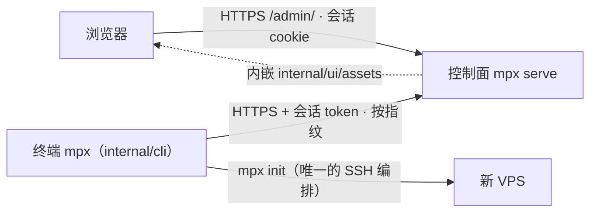

# 操作入口：CLI 与网页管理台

> **30 秒版**：操作者在浏览器打开 `https://<控制面地址>/admin/` 干活 —— 页面由 `mpx serve` 自己伺服（内嵌 `internal/ui` 构建产物），用单管理员账号登录拿会话 cookie；`mpx` 命令行是 `/api` 的纯客户端，`mpx connect` 用同一套账号密码换一枚 CLI 会话 token 存进本机配置档，按证书指纹认控制面。本机 `mpx ui` 本地服务、桌面程序与设备密码已在 UC-26 退役，没有并行期。

## 边界

负责：把操作拼成请求、把结果显示给人；CLI 多控制面配置档；管理员账号（`mpx admin` 建号 / 改密码）与接入；本机才能做的事（`mpx init` 首次安装、`mpx connect` 接入、relabel 查 IP 归属、测速）。IP 质量评级（`mpx node grade` / `mpx node regrade`、节点列表「IP 质量评级」弹窗）是两条控制面接口的普通调用：探测走 `POST /api/nodes/{id}/quality`（外部端点是 `mpx source grade` 打 `POST /api/sources/{id}/endpoints/{key}/quality`），预览与写库走 `POST /api/regrade`。带宽测量(UC-20)是本机才能做的事:控制面不下网,`mpx node bandwidth` 与管理台「测速」按钮各取 `GET /api/bandwidth/endpoint` 的端点配置 —— 网页侧由浏览器同源打 `/api`，实测下载发生在操作机视角不可达的浏览器里，所以测速与「从操作者位置探可达」的境内侧入口实际只留在 CLI 与专职探测点上;CLI 用 `internal/bwtest`(内嵌 sing-box,mixed inbound + 出站拨号)本机下载测速后 `POST /api/bandwidth/results` 回写;操作机被代理接管时先跑 `reach.TrustedPath` 金丝雀,不通则绑物理接口(`bind_interface`/`IP_BOUND_IF`)绕行,绕不了报错提示加白名单;wireguard 端点标 `unsupported`(不承载 HTTP)。测量引擎双通道:xray 专有
传输(xhttp/splithttp/httpupgrade)走按需下载的官方 xray 二进制(缓存进
`<配置目录>/mpx/xray/`,sockopt.interface 绑物理口),其余走内嵌
sing-box;`MPX_BW_ENGINE=xray` 可强制全走 xray,排查握手嫌疑用。
可测端点全是 hy2 等 UDP 路径时会被 UDP 环境卡死,这是真结论不是失败。
外部源整批 failed(该 s: 源快照里所有端点都 failed)时,`POST
/api/bandwidth/results` 不等 interval 立刻加刷一次拉新端点(端点轮换
是分钟级);panicRefreshMinGap 15 分钟限速,IntervalSeconds=0 的手动
源与刷新进行中不重复触发。
`node bandwidth --rounds` 默认 3(取最好一次):CDN 入口对单轮波动
很敏感,峰值口径在挑入口时才有意义。
UC-23:`GET /api/bandwidth/targets` 下发「带宽未测」的 host:* 名单
(每轮最多 2 个),探测端 `probeagent.Tick` 在 CDN 优选之后自动补测
(`bandwidthRound`),结果按 probe:<id> 记账 —— CDN 池子换 IP 进来的
新入口不需要人工跑 mpx node bandwidth。默认测速地址是 proof.ovh.net(speed.cloudflare.com 拦非浏览器客户端与若干 VPS 出口 403,hetzner 对 QUIC 断流),`settings.bandwidth_test_url` 或 `--url` 可换。mpx 二进制编进去的标签固定 `with_utls,with_quic`(reality 指纹 + hysteria2 出站都要),发布/CI/安装脚本同口径;没编 quic 时 hy2 端点在「起 sing-box」就死,报 initialize outbound 错误。`/local/*` 本地 job 面已随 `mpx ui` 退役;管理台同源直接调 `/api`,没有转发层与白名单。

不负责：碰数据库和节点（`mpx init` 是唯一例外，因为那时控制面还不存在，见 [安装与升级](install-update.md)）；长出控制面接口之外的能力。管理台只是 `/api` 的另一种客户端,同源调用,不承担鉴权之外的转发职责。

## 怎么运转

1. CLI 每条命令都能用 `curl` 等价做出来，不缓存数据，每次都问控制面。`mpx connect <地址>` 走 `POST /api/admin/login`（`kind: "cli"`）拿 bearer 会话 token,连同证书指纹写进本机配置档(`--profile` 分档);账号密码只出现在登录这一次,之后请求都带 token。改密码（`mpx admin password`）吊销全部会话与 CLI token,各处重新登录。
2. 网页管理台使用 React + TypeScript + Vite + shadcn/ui,构建产物嵌进二进制,由 `mpx serve` 挂在 `/admin/`（hash 路由）。`/admin` 与登录接口只受理 TLS 或回环请求;未配域名时不对公网开放,想远程管走 SSH 隧道到回环。[界面源码]。
   连接方式只在节点详情的「连接方式」卡片管理；旧地址 `#inbounds`（含子路径）跳到节点列表。详情头部有未应用改动、配置不一致或从未应用时才出现「应用到节点」主按钮，其余时候它和刷新状态、暂停 / 恢复分配、编辑一起收在「⋯」菜单。体检页行内的「应用到<节点>」不直接下发：它只跳到节点详情并留一个 10 秒有效的标记，由详情页弹确认框（用户确认才下发）；节点连不上时详情头部的「应用到节点」带 `aria-disabled`，React 事件处理检查不可用状态，只提示先刷新状态。
   界面规范由[UX 入口](../../internal/ui/ux/README.md)连接设计意图、交互模式、组件与验收。`styles/tokens.css` 是唯一项目 Token 真源；根元素的 `data-ui` 选择总览工作区或旧页兼容绑定，浮层继承当前主题。[共用组件](../../internal/ui/frontend/components/primitives.tsx)与 shadcn 控件读取同一份 Token。图标注册表由固定版本官方 Lucide 素材生成，运行时使用 `lucide-react`。应用装配、外壳、更新和页面分别持有各自职责。本机 `/components.html` 复用真实基础组件且不启动业务读取；`npm run ui:check` 校验来源与结构。实际截图和审查见[React 界面验收](../../.visual-design/react-components/review.md)。
   控制面入口在顶栏右侧状态区：会话胶囊（圆点 + 管理员名 + 主机）点开单层浮层，列出地址、版本、证书指纹（4 位一组可复制）与「退出登录」（`SessionMenu`）；侧栏只放品牌标与业务导航。管理台只对着当前这台控制面,没有切换对象 —— 换控制面就换网址,CLI 侧才有多配置档。
   总览已完成的开始清单收进页头，节点优先展示最需注意的六个，通知在页底横条中查看并跳到系统修改。首次使用默认为浅色，保存过的手动主题保持不变；Mac 使用系统滚动条，其他平台只在滚动或悬停滑块时显示细条。
   过期用户在总览和用户列表中置灰；总览只展示最近 30 天内过期的用户，较早记录通过提示跳到已过期筛选，人数仍受总览前 1000 人采样限制。续期共用确认框，按天或指定日期，超限时可另选清零；已过期筛选的多选只保留当前页，批量删除逐个调用现有接口，部分失败只重试失败名单。续期和批删提交时锁定确认框，Esc 和取消不会中断正在执行的写操作。
   订阅页是行式清单，三张卡：第一张放订阅链接行和四个字段行（链接开头、订阅名、刷新间隔、帮助链接，没有客户端预览），第二张是客户端格式对照，第三张放外部订阅入口和订阅底稿行（默认折叠，展开才取正文，会话内记住状态）。字段和识别规则先改草稿，统一由保存条通过 `modifySettings` 先读后写；放弃后的撤销只恢复当时改过的键，不覆盖后台刷新收到的其他设置。离页和切换控制面共用草稿确认，保存成功或选择不保存后才继续；对话框约束 Tab 焦点并在关闭后还原。底稿仍由原抽屉单独保存。预览用户只决定订阅链接里显示谁的链接，默认最近拉过订阅的用户，可切换；无用户时标「示例」。链接开头只由控制面在写入新值时校验，旧值未改可保存其他字段；预览保留原始链接，改链接开头后才用最后一段令牌拼接并去掉尾斜杠。规则按 Go 正则保存，浏览器无法编译时只提示无法预览、不拦截完成，空规则仍拦截；改规则后保留键盘焦点。`#sub/info`（旧的 `#sub/look` 也认）滚到 `#sec-info`，`#sub/clients` 滚到 `#sec-clients`，`#sub/templates` 展开并滚到 `#sec-adv`，旧设置路由继续映射。
   用户详情是基页上的独立叠层：打开、换人、关闭、后退只更新抽屉和面包屑，保留列表 DOM、筛选和滚动，关闭不重读列表。已有用户字段立即显示，链接、最近连接和设置并行补全，失败只在对应区块重试；二维码复用已读取的链接，不再二次查询控制面。来自分享地址且列表不含该用户时，另取用户资料。只读详情期间，基页在途后台读取只更新展示缓存，不改当前基页数据和 DOM；关闭也不补画，下一次正常刷新再采用。写后的明确刷新仍同步列表与详情。
   返回已访问的页面先显示会话内成功数据，再后台读取；最多保留最近 16 个页面或详情，键含实际读取路由和完整筛选／作用域，取存均复制。缓存命中后读取失败只提示；写开始和完成按同一资源依赖失效。节点详情也先显示成功列表中的字段，连接、报告和任务区域等待补全。订阅状态与其他独立读取并行。
   路由按目标视图立即切换标题、面包屑和加载框架，`main` 的 `aria-busy` 随框架一起输出；切换视图归零滚动，同一视图刷新保留位置。失败留在目标页重试，过期响应丢弃；后台轮询失败只提示并保留数据，手动刷新失败保留页面错误与重试。分流加载框架保留标签和规则作用域，只将列表换为骨架。异步抽屉先显示目标标题和读取状态，再通过 `usePageData` 补全内容；关闭、换页或换抽屉后不再提交旧结果。覆盖层关闭与路由变化分开处理，换页关闭旧抽屉不改写目标地址。订阅同页锚点保留草稿并立即定位，控制面切换先显示连接中，成功后重载。守卫见 `nav-loading.spec.mjs`。
   异步交互通过 `Button loading` 与局部忙态立即显示进行中状态，原生控件值不冒充保存成功；失败恢复原选择并保留原页面错误提示。`usePageData` 加载器的 `read` 只在明确的局部刷新中复用当前页面成功整页读取的快照，键包含完整接口路径、查询参数、方法和只读请求体；作用域与筛选不会串用。只有当前代次的完整读取可替换快照，局部读取返回副本且不回写。写开始、完成均失效相关资源；用户列表、计数和套餐人数一起失效。手动刷新、切页和每 30 秒轮询仍读远端，不复用旧请求快照；切页重新读取，完整成功后更新请求快照；展示缓存先呈现。`node scripts/ui-interaction-audit.mjs` 在现有 e2e 路径中加入 150–300ms 响应延迟，输出交互反馈、完成和接口耗时表；正式延迟守卫在 `interaction-latency.spec.mjs`。
   本机转发与 CLI 的连接池每主机保留最多 16 个空闲连接，证书钉住和 HTTP/1.1 不变；控制面仅对已鉴权管理 JSON 协商 gzip，大于等于 1KB 才压缩，解压字节保持原样。备份流和订阅不经过 JSON 压缩。相关守卫见 `data-reuse.spec.mjs`。
   外部订阅与自建节点共同收纳在「节点」页的二级页签（`自建节点 | 外部订阅 | 探测点`，对应 `#nodes` / `#nodes/sources` / `#nodes/probes`，旧地址 `#sources` 跳到外部订阅）；订阅页第三张卡仍保留跳转入口。节点列表在有指标数据时长出「境内」列(稳定度成功率·时延 + 带宽展示值·测量时间),行尾「测速」与源成员行同列指标同按钮;节点详情维护卡加「境内指标」行,触达抽屉加「境内指标」段(UC-20)。「探测点」页签（UC-12）放自动剔除开关与周期（写 `settings.reach_exclude` / `reach_interval_minutes`）和探测点名册（增删、凭据轮换，接入命令只在创建时给一次）；剔除开着时节点列表顶部挂提示条，行内「已剔除 / 保留中」标与「保留」按钮对应 `PUT /api/reach/keep`。页面通过来源接口在单张可展开来源表内展示接收用户与状态，行内按需展开只读节点成员，点来源进入分段详情抽屉（`配置与授权` / `节点与格式` 单次保存；接收用户分按人、按套餐两块勾选，保存同发 `users` 与 `plan_ids`），混合订阅预览按需弹窗查看。对应命令为 `mpx source`，`grant`/`revoke` 同时接受 `--user` 与 `--plan`（套餐名唯一，按名定位）。来源详情只显示遮蔽地址和元数据，刷新结果独立轮询，不覆盖正在编辑的表单。混合预览按用户与格式生成，策略组支持来源条件和按用户预览；来源条件使用专用接口保存。截图与独立审查记录见[混合订阅界面验收](../../.visual-design/mixed-sources/review.md)。
3. 接入与凭据：控制面自签证书，CLI 记指纹；控制面配了域名(`mpx acme` / 管理台「域名与证书」)后 `mpx connect <域名>:<端口>` 会先探系统是否信任其证书，信则记 `ca: true` 走普通 TLS，否则仍回落到按指纹认自签的那条路 —— `--fp` 显式给指纹时跳过探测直连指纹模式。设备密码与逐台吊销已删（`device_password` 表、`POST /api/connect`、`/api/devices*` 全退役）;单设备丢失的吊销粒度是「改密码吊销全部会话与 CLI 凭据」。
   免密码接入（UC-28）：`mpx connect <地址> --ssh [目标]` 不问密码，CLI 经系统 `ssh` 在控制面所在服务器上跑 `mpx admin session`（以 `/etc/mpx/env` 的主钥匙调 `POST /api/admin/session`,该口只认主钥匙、会话凭据不能用它续命），拿回一枚 `kind=ssh` 会话存进 profile;SSH 目标一并记下（不带值时取连接地址的主机名），之后任何请求收到 401 就自动经同一条 ssh 再铸一次重放一次，人不再输密码。`mpx init` 收尾把 init 用的 `user@host -p port` 写进 profile,与 `--ssh` 的续期是同一个机制。`--ssh-cmd` 覆盖默认远端命令（非默认安装路径/端口时用）;目标串按空白切开转给 `ssh`,别名、`-p`、Jump 都由 `~/.ssh/config` 与系统 ssh 处理。

## 坑

- 给管理台加功能时直接调一个新接口 → 没有转发白名单拦,但「每个写操作要有等价命令」的边界还在 → 先确认 CLI 有对应能力。
- 页面轮询远端任务（升级、签发证书）要走「按 seq 增量拉事件」的形状,不整包重读。
- 窗口里不出现命令行用语（v0.9.1 起）→ 控制面原话带命令的错误和自检建议另给 `ui_hint`，页面优先显示，CLI 照旧用原话（[对外契约](../internal/contracts.md)）→ 新加报错时别把 `mpx …` 写进只会出现在页面里的文字。
- 撞上控制面限流 → CLI 自己等，不把 429 甩给使用者。
- 登录接口限速与锁定复用 `/api/connect` 时代的三道闸（IP 限速 + 连续失败锁 15 分钟）;测试环境用 `MPX_API_BURST` 放宽。
