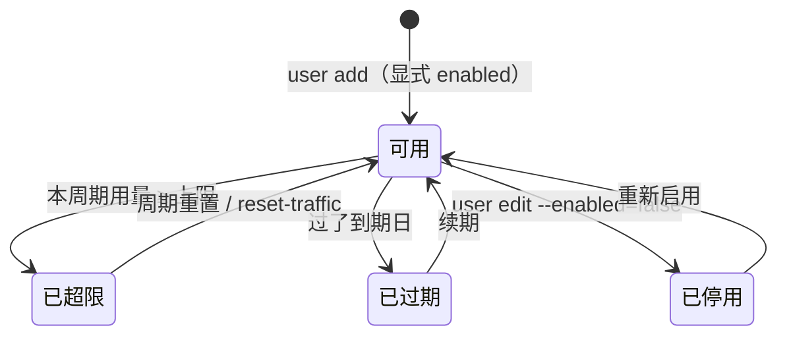

# 用户、套餐与计量

> **30 秒版**：一个用户就是一个能拿订阅的人：有自己的流量上限、重置周期、到期日和启停开关。他能用哪些入站，由挂的套餐（一组节点或入站权限）加上可选的「额外授权」决定。流量按人、按节点累计进库，超了或到期，下一轮就被摘下、订阅变成写明原因的占位节点。

## 边界

负责：用户与套餐的数据和规则、授权计算（谁能用哪个入站）、流量记账、周期重置、到期判断、提醒。

不负责：把结果送到节点（[节点](nodes.md)）；订阅长什么样（[订阅与分流](subscription.md)）；管理员和多租户（明确不做，见 [设计](../design.md)）。

## 怎么运转

1. 授权 = 套餐 ∪ 额外授权（用户自己的 `inbound_ids`）。系统自带「默认套餐」，`all_nodes=true`，新加的节点也自动包含，可以编辑不能删除。规则来自 [套餐方案](../internal/plans-rfc.md) 的已定案部分。
2. 用量来自后台采样的差值，按人汇总到 `users.used_traffic`；重置按周期把本期用量归零，放在采样之后。
3. 状态判定（超限、过期、停用的优先级和边界值）写在 [数据模型与语义](../internal/model.md) 的「用户状态」，代码在 [internal/model](../../internal/model/)。

## 坑

- 想把用户「移出套餐」→ 没挂套餐又没有 `inbound_ids` 的用户按旧语义能用**全部**入站，权限会悄悄放大 → 接口拒绝 `plan_id: null`，要放宽就明确改挂默认套餐。
- 旧客户端只带 `inbound_ids` 建用户 → 不挂套餐，按旧语义只能用这些入站 → 这是有意的，避免和默认套餐取并集变成全部。
- 迁移来的用户保留了 `inbound_ids` 作为额外授权 → 从套餐里去节点收窄不了他们 → 先清空额外授权。
- CSV 导入逐行独立提交（decisions 第 25 条）→ 中途失败时前面的行已经写进去 → 看导入报告逐行处理。
- 提醒阈值写 0 → 表示关闭，不是「到 0 才提醒」（decisions 第 27 条）。
