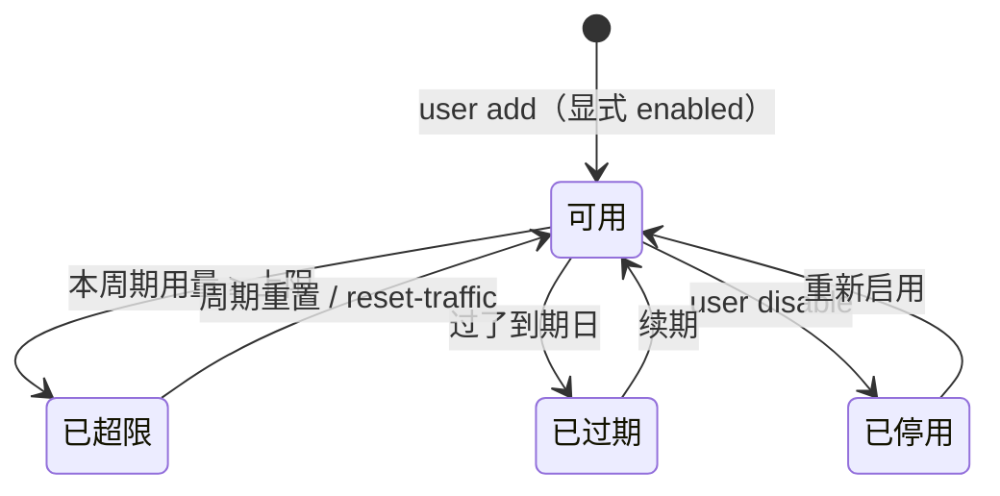

# 用户与计量

> **30 秒版**：一个用户就是一个能拿订阅的人：有自己的流量上限、重置周期、到期日和启停开关。他能用哪些入站，直接由用户自身的 `inbound_ids` 决定（留空表示全部入站，非空表示白名单）；外部订阅源由来源的 `grant_all` 全员开关或 `user_source_grants` 按人授权决定。流量按人、按节点累计进库，超了或到期，下一轮就被摘下、订阅变成写明原因的占位节点。

## 边界

负责：用户的数据和规则、入站授权计算（`User.AllowsInbound`）、流量记账与 7 天历史采样清理、周期重置、到期判断、提醒。

不负责：把结果送到节点（[节点](nodes.md)）；订阅长什么样（[订阅与分流](subscription.md)）；套餐分级、批量 CSV 导入、管理员账号与多租户。

## 怎么运转

1. **授权规则**：`user.InboundIDs` 为空表示全部入站，非空时仅允许列表内的入站（唯一判定入口 `User.AllowsInbound`）。
2. **计量与重置**：用量来自后台采样的差值，按人汇总到 `users.used_traffic`；重置按周期把本期用量归零，放在采样之后；`traffic_samples` 每小时清理 7 天前旧行并保留每个 `(node_id, core, username)` 的最新基线。
3. **状态判定**：超限、过期、停用的优先级和边界值写在 [数据模型与语义](../internal/model.md) 的「用户状态」，代码在 [internal/model](../../internal/model/)。

## 坑

- 建用户可显式带 `sub_token`（`POST /api/users`、`mpx user add --sub-token`）：服务端只对合法 token 采纳，非法仍回退自动生成 → 迁库能原样带上旧面板的订阅 token，不用等它自然轮换。
- 提醒阈值写 0 → 表示关闭，不是「到 0 才提醒」。
- `user.InboundIDs` 留空表示「可用全部入站」→ 要把某用户挡在新入站之外，必须显式列出允许的入站 ID。
